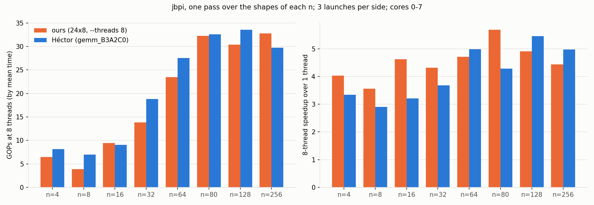
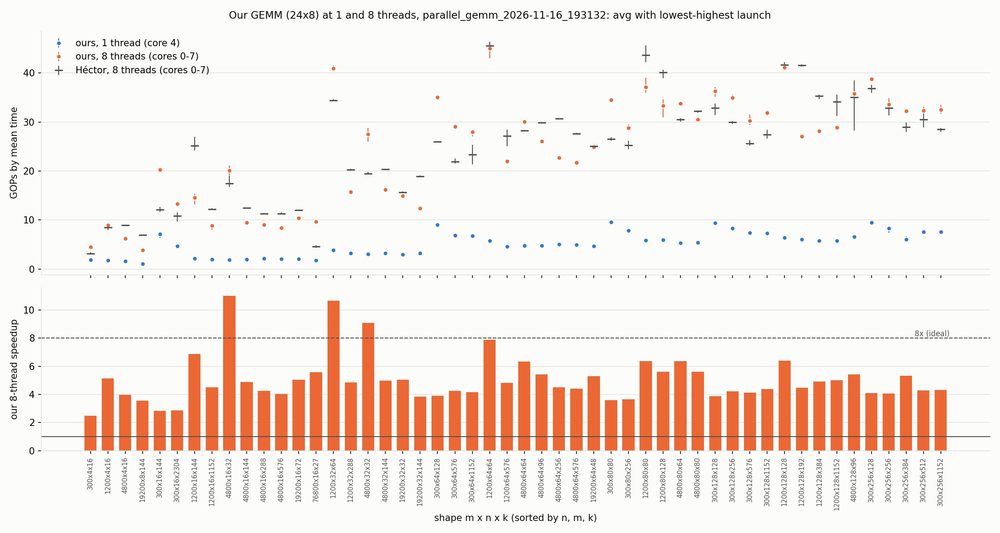

# Issue #56 engineering report: our GEMM on 8 threads, tested on YOLO26

2026-11-16 · board jbpi · branch `make-the-design-parallel-for-the-gemm-test-and-test-it-on-one-specific-program` (code at `f9e7c857`) · issue write-up `.scratch/issues/0040-parallel-gemm-design.md`

## 1. Question

Can our generated GEMM run on 8 cores, stay correct, and how does it compare with Héctor's `gemm_B3A2C0` (#62) on the YOLO26 shapes?

Short answer:
- **It runs and is correct.** 8 threads: 50 of 50 shapes PASS in each of 3 launches.
- **Speedup: 4.59x by mean time** (4.71x by median rep) over one pass of the 50 shapes. Héctor's is 4.30x.
- **Héctor is still faster overall:** 152.1 ms per pass for us, 135.7 ms for him, at 8 threads. The gap comes from 1 thread (698.6 ms against 583.3 ms), not from the parallel split.

## 2. What was built

`--threads N` on the generator and on `compile_macro_bench.sh`. The default is 1, and **with 1 thread the generated project is byte-identical** to before (tested), so every earlier result stays valid.

With N > 1 the macrokernel runs inside one OpenMP region per GEMM call:

| step | who | barrier |
|---|---|---|
| `jc`, `pc` loops | every thread walks them | – |
| pack B (`kc x nc` into Bc) | split over (panel x k-chunk) units, round robin | one, after the pack |
| pack A rows and compute | each thread owns `mr` panels of the `mc` block (the `ir` split) and packs only its rows into the shared Ac | none per full `ic` block |
| short last `ic` block | its panel split differs, so a thread could overwrite Ac rows another still reads | one, before it |
| end of `pc` | Bc and Ac are reused next | one |

Changes from Héctor's scheme (#62 copy/change/skip list):
- **Fewer barriers.** We drop his barrier per `ic` block: one barrier per `pc`, plus one before a short last block.
- **B pack split along k.** He gives B pack work only to the threads that own a column slice: 1 thread at n = 4 or 8, 2 at n = 16. We split each `nr` panel along k as well, so all 8 threads pack at every n.
- **Blocking unchanged:** our one-core cache model. On YOLO26 its `mc` is 300-4096, at least 12 panels of 24 rows, so every thread gets work.

Limits:
- fp32 AXPY only.
- Uninstrumented build only: the pack and kernel timers are not thread-safe.
- The vector packers only. The script refuses `--instr`, `--no-ref-protocol`, `--scalar-pack`, `--pack-b` other than `row`, `--zero-pack-lines`, `--cpu` and `--no-pin` together with `--threads`.

### Tests
- `test_parallel_gemm.py` builds the real 3- and 8-thread dispatch on the host with OpenMP and scalar stand-in kernels, on NaN-filled Ac/Bc. Six cases run 20 times each, beta 0 and 0.5.
- The cases cover one B panel narrower than `nr`, k shorter than the k-chunk count, a short last `ic` block, fewer A panels than threads, and several `jc`/`pc` blocks.
- **Removing either barrier makes the test fail.**
- Full suite: 604 passed.

## 3. Run

`run_parallel_gemm.sh` with `config_parallel_gemm.json` (tile 24x8, `skip_ref_run` off):
- Board jbpi. Uninstrumented, reference protocol, `--tmin 2`, `--no-nc-overrides`.
- 1 thread on core 4. 8 threads on cores 0-7 with `OMP_PROC_BIND=close OMP_PLACES=cores`.
- Order 1T 8T 8T 1T 1T 8T, from 19:31 to 20:00.
- No other user's job on the board before or after any launch (`load_jbpi_L*.txt`).

| launch | threads | run folder | check |
|---|---|---|---|
| 1 | 1 | `run_2026-11-16_193618` | 50 PASS |
| 2 | 8 | `run_2026-11-16_194037` | 50 PASS |
| 3 | 8 | `run_2026-11-16_194504` | 50 PASS |
| 4 | 1 | `run_2026-11-16_194944` | 50 PASS |
| 5 | 1 | `run_2026-11-16_195424` | 50 PASS |
| 6 | 8 | `run_2026-11-16_195855` | 50 PASS |

Our 1-thread pass, 698.6 ms by mean time, matches #61's 24x8 pass (698.6 ms, same board and settings). The 1-thread path is unchanged.

## 4. Results

### One pass over the 50 shapes

| | 1 thread | 8 threads | speedup |
|---|---|---|---|
| ours, by mean time | 698.6 ms · 4.26 GOPs | 152.1 ms · 19.55 GOPs | 4.59x |
| ours, by median rep | 698.2 ms · 4.26 GOPs | 148.3 ms · 20.05 GOPs | 4.71x |
| Héctor (#62 jbpi), by mean time | 583.3 ms · 5.10 GOPs | 135.7 ms · 21.91 GOPs | 4.30x |

### By n

| n | shapes | ours 1T | ours 8T | ours speedup | Héctor 1T | Héctor 8T | Héctor speedup |
|---|---|---|---|---|---|---|---|
| 4 | 3 | 1.61 | 6.49 | 4.03x | 2.44 | 8.15 | 3.34x |
| 8 | 1 | 1.09 | 3.87 | 3.56x | 2.40 | 6.95 | 2.90x |
| 16 | 10 | 2.05 | 9.47 | 4.62x | 2.83 | 9.06 | 3.21x |
| 32 | 6 | 3.20 | 13.82 | 4.32x | 5.12 | 18.84 | 3.68x |
| 64 | 10 | 4.98 | 23.46 | 4.71x | 5.53 | 27.54 | 4.98x |
| 80 | 6 | 5.68 | 32.30 | 5.68x | 7.61 | 32.57 | 4.28x |
| 128 | 9 | 6.20 | 30.43 | 4.91x | 6.14 | 33.54 | 5.46x |
| 256 | 5 | 7.40 | 32.82 | 4.44x | 5.99 | 29.77 | 4.97x |

GOPs by mean time. Each n is one pass over the shapes with that n.

- **n ≤ 32: we scale better, but start lower.** Our speedup is 3.6-4.6x, his 2.9-3.7x, which fits the k-split B pack. Our 1 thread is 1.4-2.2x slower than his, so his 8 threads stay ahead at n = 4, 8 and 32; we lead at n = 16.
- **n ≥ 64: mixed.** Level at n = 80 (32.30 against 32.57), behind at 64 and 128, ahead at 256.

### Per shape

We match or beat his 8 threads on 25 of 50 shapes. The full table, with both GOPs metrics and the spread over launches, is in `../parallel_gemm_2026-11-16_193132/parallel_gemm_report.md`. Shapes worth a look:

| shape | ours 1T → 8T (by mean time) | speedup | Héctor 8T | note |
|---|---|---|---|---|
| Y00 76800x16x27 | 1.73 → 9.67 | 5.58x | 4.61 | his worst case (#62: 300 `ic` blocks, a barrier each); ours 2.1x his |
| Y10 4800x16x32 | 1.82 → 20.07 | 11.02x | 17.50 | above 8x: our 1-thread run is slow there; cause not measured |
| Y29 1200x32x64 | 3.83 → 40.90 | 10.67x | 34.40 | the same |
| Y47 300x4x16 | 1.83 → 4.53 | 2.47x | 3.16 | 13 panels of 24 rows over 8 threads, tiny k |
| Y05 19200x8x144 | 1.09 → 3.87 | 3.56x | 6.95 | n = 8 with a 24x8 tile; our 1 thread is 2.2x slower than his |
| Y24 1200x128x192 | 6.04 → 27.09 | 4.48x | 41.54 | our worst ratio against him at large n (0.65) |

**Mean against median at 8 threads.** On the m = 300 and m = 1200 shapes with n ≥ 64, the median rep is well above the mean. Examples: Y34 37.11 against 49.81, Y43 38.75 against 49.15, Y37 36.36 against 44.69. So some 8-thread reps are much slower than the rest. At 1 thread they mostly agree within 2% (largest gap: Y44, 8.31 against 8.73). Slow reps were not looked into (candidates: thread wake-up, core 0's interrupts, the L2 shared per 4-core cluster).

## 5. Limits of the comparison

- **Not interleaved.** Héctor's series ran 8 hours earlier (#62, 11:14) on the same board and cores. House rule 2 asks A-B-B-A inside one series for a gap under 3%; most gaps here are larger, but a 1-3% difference (for example n = 80) is not settled.
- **Different tiles and blocking.** Ours: 24x8 everywhere, cache-model `mc/nc/kc`. His: 16x8 (16x4 at n = 4), MC = 256, KC = 256, NC = n. Part of the 1-thread gap is the tile; #61 found 24x9 or 32x7 faster than 24x8 at some n.
- **Mean only for him.** His driver reports the mean time, so the median column has no partner.
- **Core 0** is in every 8-thread run, ours and his (user's exception). The 1-thread runs use core 4.

## 6. What this unblocks

S6 (#63) can now run our side: the size search at `--threads 8` and A-B-B-A launches against his GEMMLib. The open points from §5 belong there:
- the best tile per n at 8 threads;
- the 4 + 4 per-cluster test;
- interleaved launches against his GEMMLib;
- the slow 8-thread reps.

Not done here: a per-thread `mc`. Today's `mc` already gives every thread at least one panel on YOLO26.
