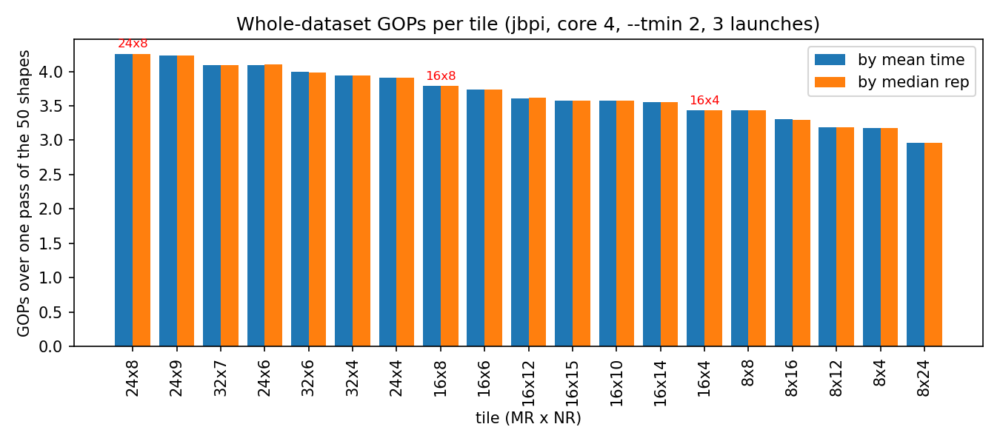
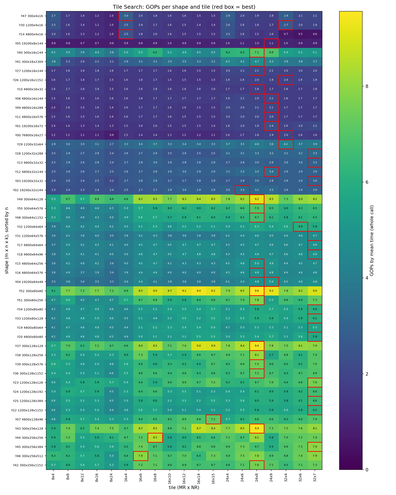

# Microkernel Tile Selection for YOLO26 GEMM Workloads on a Single SpacemiT X60 Core

**Technical Report — Issue #61 (S3: one-core sweep), with the tooling of #59 and #60**

| | |
|---|---|
| Project | RVV_code_gen_via_MLIR_xDSL — generated RISC-V Vector GEMM microkernels |
| Parent issue | #58 (best microkernel size per GEMM shape for Héctor Martínez's YOLO26 on the K1) |
| Covered issues | #59 (shape set), #60 (search tooling), #61 (one-core sweep) |
| Branch / PR | `yolo26-k1-best-microkernel-size-per-gemm-shape`, PR #64 into `pure-xdsl` |
| Measurement dates | 15–16 November 2026 |
| Report date | 16 November 2026 |
| Status | Results final for one core; correctness on the full-size shapes not yet run (§7.3) |

---

## Abstract

The YOLO26 network, as run by Héctor Martínez's GEMMLib on the SpacemiT K1, issues 50 distinct single-precision GEMM shapes (excluding three matrix–vector shapes with n = 1). His library uses a fixed 16×8 register tile (16×4 when n = 4). This report asks which register tile (MR × NR) gives the highest throughput on each of those shapes on one X60 core, and how far the fixed choice is from the best. A Tile Search tool was added to the project generator, and 19 candidate tiles were measured on all 50 shapes in three launches on a dedicated board core under the project's benchmarking house rules. The best single tile for the whole network is **24×8**, which delivers **4.26 GOPs by mean time (4.25 by median rep)** over one pass of the 50 shapes, against **3.79 / 3.79 GOPs for 16×8**: an 11 % reduction in time per pass (698.6 ms against 785.3 ms). 24×8 ranks first in each of the three launches. Choosing the tile per output width n raises this to 4.37 GOPs, and an oracle choosing per shape reaches 4.43 GOPs. Results are for one core, a 2 s minimum timing window, and our packing scheme; they are a baseline for the forthcoming eight-thread study (#63).

---

## Contents

1. Introduction
2. Background
3. Method
4. Changes Made
5. Verification
6. Results
7. Discussion
8. Conclusions
9. Recommendations and Further Work
10. References
- Appendix A — Per-shape results
- Appendix B — Reproduction
- Appendix C — Files added or changed

---

## 1. Introduction

### 1.1 Context

GEMM (C = A·B) dominates convolutional inference once each convolution is lowered with im2col. In a BLIS-style GEMM the innermost routine, the *microkernel*, updates an MR × NR block of C held in vector registers. The tile size is a trade-off: larger tiles amortise loads of A and B over more multiply–adds, but consume more registers and waste work when the matrix dimensions are not multiples of the tile.

Héctor Martínez (collaborator) runs YOLO26 on the SpacemiT K1 (eight X60 cores, RVV 1.0, VLEN = 256 bits) and asked which microkernel sizes suit the network's GEMM shapes. His library fixes 16×8 for fp32 (16×4 when n = 4).

### 1.2 Aim and objectives

**Aim:** identify the fastest register tile for each YOLO26 GEMM shape on one X60 core, and quantify the gap to the tiles Héctor uses.

Objectives:

1. Fix the shape set and the candidate tiles (#59).
2. Add a Tile Search to the project generator: measure a list of tiles on a dataset and report the best per shape (#60).
3. Verify that every candidate tile computes correctly (#60).
4. Run the search on the board under the project's house rules and report the best tile per shape, per output width n, and for the whole network (#61).

### 1.3 Scope

In scope: fp32, one core, our generated GEMM (pack A and B on every call), the 50 GEMM shapes. Out of scope: multi-threading (#56, #63), fp16, the three GEMV shapes (n = 1), and Héctor's pre-packed im2col path.

---

## 2. Background

### 2.1 Loop nest

The generated GEMM follows the BLIS five-loop order used by both codes (B3A2C0: B block in L3, A block in L2, C in registers):

```text
for jc in 0..n step nc          # loop 1
  for pc in 0..k step kc        # loop 2   pack B[kc x nc]  -> Bc
    for ic in 0..m step mc      # loop 3   pack A[mc x kc]  -> Ac
      for jr in 0..nc step NR   # loop 4
        for ir in 0..mc step MR # loop 5   microkernel: C[MR x NR] += Ac . Bc
```

Our cache blocking (mc, nc, kc) comes from a cache model; partial (fringe) tiles go through a temporary MR × NR buffer.

### 2.2 Register budget

With VLEN = 256 and fp32, one vector register holds 8 elements, so MR is a multiple of 8. An MR × NR AXPY-style microkernel holds (MR/8)·NR accumulators plus MR/8 registers for the column of A, and the X60 has 32 vector registers:

$$ \frac{MR}{8}\,(1 + NR) \le 32 $$

### 2.3 Shape characteristics

The 50 shapes have m from 300 to 76 800 (output pixels), n ∈ {4, 8, 16, 32, 64, 80, 128, 256} (output channels), and k from 16 to 2 304. Because n is small, NR largely determines how much of the last column block is wasted (for example NR = 15 on n = 16 computes almost a whole second tile of padding).

---

## 3. Method

### 3.1 Workload

`tests/pure_xdsl_blis_rvv/datasets/yolo26_k1.dat`: Héctor's CSV of one YOLO26 inference (`HectorYolo/yolo26_k1_matrix_sizes.csv`, identical to `gemm_study/yolo.dat` at GEMMLib commit `b292c92`), rows 6, 21 and 35 (n = 1) removed. Shape label `Y<l>` is row *l* of the CSV. Each distinct shape is counted once; the CSV carries no call counts (§7.4).

### 3.2 Candidate tiles

Nineteen tiles, agreed in #59 §3.2: NR in steps of two plus the largest NR the register budget allows, and NR = 4 for every MR (for the n = 4 shapes).

| MR | NR | Registers at largest NR |
|---|---|---|
| 8 | 4, 8, 12, 16, 24 | 25 |
| 16 | 4, 6, 8, 10, 12, 14, 15 | 32 |
| 24 | 4, 6, 8, 9 | 30 |
| 32 | 4, 6, 7 | 32 |

### 3.3 Apparatus

| Item | Value |
|---|---|
| Board | `jbpi`, SpacemiT K1, eight X60 cores, two L2 clusters (cores 0–3, 4–7) |
| ISA | rv64imafdcv, VLEN 256, zvfh |
| OS / kernel | Bianbu Linux 6.6.63 riscv64 |
| Compiler | GCC 13.2.0 (Bianbu 13.2.0-23ubuntu4bb3), `-O2 -march=rv64gcv` |
| Frequency governor | `performance` on all eight cores |
| Core | 4, pinned with `taskset` (house rule 1: never core 0) |
| Build | uninstrumented (`RVV_INSTRUMENTED=0`) |
| Packer | vector packer, `--no-nc-overrides` (cache-model blocking) |

### 3.4 Measurement protocol

- **Reference protocol** (the project default): no warm-up; repeat the whole GEMM call, packing included, until at least `tmin` seconds have passed; record every repetition's time. `tmin = 2 s`, as Héctor uses (`TIMIN=2.0`), decided in #61 §2b. This is a screening-level window; the project's usual window is 10 s.
- **Three launches** (house rule 2). One launch is one `compile_macro_bench.sh` run of all 19 tiles. The tile order is rotated between launches (offsets 0, 7, 14: launches start at 8×4, 16×8, 24×8) so that no tile is always first or last and slow drift spreads across tiles instead of biasing one.
- **Idle board.** Before each launch the runner read the board's process list and would wait while another user's job used ≥ 20 % CPU; it read it again after each launch. No other user's load was seen at any point. Per-core busy share during each tile's timing was 99–100 % on core 4 and ≤ 2 % elsewhere (one tile 90 %).
- **Same compiler and source for all three launches**: the three rotated configurations contain the same 19 rows (identical checksums after sorting).

### 3.5 Metrics

For each (shape, tile, launch), from the per-rep log:

- **GOPs by mean time** = 2mnk / mean repetition time.
- **GOPs by median rep** = 2mnk / median repetition time.

Both are reported (project rule). Per shape, the three launches are averaged; the spread is given as lowest–highest launch.

For a set of shapes S (the whole dataset, or all shapes with a given n), a tile's **time per pass** is Σ_{s∈S} 2mₛnₛkₛ / GOPsₛ, each shape counted once, and the **GOPs over the pass** is total operations over that time. Ranking by time per pass weights each shape by its work, so a large shape counts more than a small one, as in the network.

### 3.6 Analysis

`search_report.py` reads the per-rep logs of the three run folders and produces the per-shape table, the whole-dataset ranking, the per-n ranking, a shape × tile grid of GOPs, and a heatmap (Figure 2). It prints a warning if any shape has fewer than three launches or uneven launch counts; neither occurred.

---

## 4. Changes Made

### 4.1 Design decision

The search reuses the generator's existing *pinned* mode (one compiled tile per project) rather than adding a new mode: a search configuration is a list of pinned rows, one per candidate tile. A tile therefore times identically alone or within a search, and no generator or driver code changed (#60 decision Q1, option a).

### 4.2 Additions

| Component | Issue | Purpose |
|---|---|---|
| `datasets/yolo26_k1.dat` | #59 | The 50 shapes |
| `config_yolo_search.json` | #60 | 19 pinned rows on the YOLO dataset, correctness check off |
| `config_yolo_correctness.json`, `datasets/yolo_correctness_small.dat` | #60 | Same tiles on 4 small YOLO-like shapes (m = 300; n = 4, 16; k = 9, 27) with the scalar oracle on |
| `search_report.py` | #60, #61 | Best tile per shape (both metrics, launch spread, compare tile), per dataset and per n; GOPs grid; `--heatmap` |
| `run_yolo_sweep.sh` | #61 | Unattended series: picks the first idle board, rotates the tile order per launch, waits while another user is busy, checks completeness (19 logs × 50 shapes), stops on any failure |
| `test_tile_search.py` (10 tests), `test_run_yolo_sweep.py` (9 tests) | #60, #61 | Unit tests on hand-made run folders and on a stubbed board |
| `CONTEXT.md`, `README.md`, `docs/agents/execution.md` | #60, #61 | Glossary terms (Tile Search, Candidate Tile, Workload) and usage |

Full list: Appendix C.

### 4.3 Review

Both tools went through a two-axis code review (standards and spec). Fixes applied included: stopping the series on a failed or incomplete launch; checking that every per-rep log holds all 50 shapes; rejecting run folders that mix datasets or packers; and a warning for uneven launch counts.

---

## 5. Verification

| Check | Method | Result |
|---|---|---|
| Kernel correctness | `config_yolo_correctness.json` on `jbpi`, core 4, `tmin = 0.2 s`: 19 tiles × 4 shapes against the scalar oracle | **76 / 76 PASS** (`logs/run_2026-11-15_203822`) |
| Completeness | Runner check after each launch | 3 / 3 launches: 19 per-rep logs, each with all 50 shapes |
| Tile identity | Each of 2 850 console result lines names the tile under test | 0 mismatches |
| Report selection | Best tile per shape recomputed from the console logs (independent of the per-rep files) | Agrees on 49 / 50 shapes; the exception (Y11) is a 0.1 % tie that 2-decimal rounding in the console log flips; full precision confirms the report |
| Report arithmetic | Four values checked by hand against `jbpi_L1.log` | All match |
| Unit tests | `pytest` | Full suite 570 passed before the series; affected files 24 passed after |

---

## 6. Results

All figures: `jbpi`, uninstrumented build, reference protocol, `tmin = 2 s`, core 4, `--no-nc-overrides`, three launches, whole GEMM call including packing.

### 6.1 Whole network

**Table 1 — Top tiles and Héctor's tiles over one pass of the 50 shapes.**

| Rank | Tile | Time per pass, by mean time (ms) | GOPs by mean time | Time per pass, by median rep (ms) | GOPs by median rep |
|---|---|---|---|---|---|
| 1 | **24×8** | **698.6** | **4.26** | 698.9 | 4.25 |
| 2 | 24×9 | 703.2 | 4.23 | 702.4 | 4.23 |
| 3 | 32×7 | 726.2 | 4.09 | 725.8 | 4.09 |
| 4 | 24×6 | 726.4 | 4.09 | 724.3 | 4.10 |
| 8 | 16×8 | 785.3 | 3.79 | 785.1 | 3.79 |
| 14 | 16×4 | 865.3 | 3.44 | 865.0 | 3.44 |
| 19 | 8×24 | 1002.5 | 2.97 | 1002.5 | 2.97 |

24×8 ranks first in every launch (4.255, 4.241, 4.269 GOPs by mean time), ahead of 24×9 (4.229, 4.228, 4.228) and 16×8 (3.781, 3.784, 3.794).



**Figure 1 — GOPs over one pass of the 50 shapes, per tile, by mean time and by median rep.**

### 6.2 Per output width n

**Table 2 — Best tile per n (least time over that n's shapes), with Héctor's tiles. Cells: GOPs by mean time / by median rep.**

| n | Shapes | Best tile | Best | 16×8 | 16×4 |
|---|---|---|---|---|---|
| 4 | 3 | 24×4 | 2.50 / 2.54 | 1.66 / 1.67 | 2.50 / 2.52 |
| 8 | 1 | 24×9 | 1.12 / 1.12 | 0.88 / 0.88 | 0.86 / 0.86 |
| 16 | 10 | 24×9 | 2.12 / 2.12 | 1.67 / 1.67 | 1.63 / 1.63 |
| 32 | 6 | 24×9 | 3.21 / 3.21 | 2.81 / 2.81 | 2.59 / 2.59 |
| 64 | 10 | 24×8 | 4.97 / 4.98 | 4.51 / 4.52 | 4.01 / 4.01 |
| 80 | 6 | 32×7 | 5.90 / 5.88 | 5.29 / 5.27 | 4.55 / 4.56 |
| 128 | 9 | 32×7 | 6.61 / 6.62 | 6.01 / 6.01 | 5.11 / 5.11 |
| 256 | 5 | 24×8 | 7.60 / 7.56 | 7.25 / 7.28 | 6.17 / 6.18 |

For n = 4, Héctor's 16×4 ties the best tile (2.50 GOPs by mean time each).

### 6.3 Selection rules compared

**Table 3 — GOPs by mean time over one pass of the 50 shapes under four tile-selection rules.**

| Rule | Time per pass (ms) | GOPs |
|---|---|---|
| Héctor's rule: 16×8, or 16×4 when n = 4 | 785.2 | 3.79 |
| One tile for all shapes: 24×8 | 698.6 | 4.26 |
| One tile per n (Table 2) | 681.2 | 4.37 |
| Oracle: best tile per shape | 671.2 | 4.43 |

### 6.4 Per shape



**Figure 2 — GOPs by mean time per shape (rows, sorted by n, m, k) and tile (columns); the best tile per shape is boxed in red.**

Wins per tile across the 50 shapes: 24×8 (17), 32×7 (15), 24×9 (7), 32×4 (4), 16×4 (2), and one each for 24×6, 16×15, 32×6, 16×8 and 16×6. 16×8 is the best tile on one shape (Y44, 300×256×256). The largest per-shape gaps to 16×8 are Y41 (300×16×2304: 4.66 against 3.16 GOPs), Y39 (300×128×576: 7.49 against 5.60) and Y23 (1200×128×128: 7.61 against 5.85). The full table is in Appendix A.

### 6.5 Repeatability

Launch-to-launch spread of GOPs by mean time, (highest − lowest)/mean over the 950 (shape, tile) pairs: median 0.7 %, 95th percentile 9.3 %, maximum 39.9 % (Y45 with 24×8: 6.04, 5.71 and 8.39 GOPs). 190 of the 950 pairs exceed 3 %. On 29 of the 50 shapes the best tile is within 3 % of the runner-up; on 35 the best tile's lowest launch exceeds the runner-up's highest.

---

## 7. Discussion

### 7.1 Why taller tiles win

The winning tiles (24×8, 24×9, 32×7) use 27–32 of the 32 vector registers and have MR ≥ 24. A taller tile reuses each loaded element of B over more rows of A, and the YOLO shapes are tall and narrow (m ≫ n), so MR has room to grow while NR is held back by small n. MR = 8 tiles are the slowest throughout (2.97–3.43 GOPs over the dataset): one register per column of A gives the least reuse, and a larger NR makes them slower still, not faster. The n = 4 shapes favour NR = 4 at every MR, as expected, since any wider tile computes padding.

### 7.2 Practical significance

A single change of tile, 16×8 → 24×8, removes 11 % of the single-core GEMM time over the network's distinct shapes. Selecting per n gains a further 2.5 %, and a per-shape oracle another 1.5 %; the per-n rule captures most of the available gain with eight entries.

### 7.3 Limitations and threats to validity

1. **Correctness on the full-size shapes was not run.** The sweep configuration skips the scalar check (it would dominate board time). The same kernels pass on four small YOLO-like shapes, but larger shapes exercise cache-blocking paths those do not.
2. **Timing window.** `tmin = 2 s` is a screening window. The launch spread (§6.5) exceeds the house rule's 3 % on 20 % of (shape, tile) pairs, so per-shape winners within about 3 % of the runner-up (29 shapes) are not distinguishable; the whole-network and per-n rankings, which sum over many shapes, are stable across launches.
3. **Packing differs from Héctor's.** Our GEMM packs A on every call; his phase-3 path receives A pre-packed from im2col. Our blocking comes from a cache model; his is fixed (MC = KC = 256, NC = n). The comparison is of tiles within our GEMM, not of the two libraries.
4. **One core.** With eight threads the cores share L2 (per cluster of four) and memory bandwidth; the ranking may change (#63).
5. **Shape weighting.** Each distinct shape is counted once. The CSV has no call counts per inference, so time per pass is not time per image.
6. **Board conditions.** The load average was about 3.0 throughout, caused by two kernel threads (`vq0`, `vq1`) in uninterruptible sleep since boot; they use no CPU (per-core busy share shows only core 4 active).

### 7.4 Anomaly: Y14 with MR = 32

On Y14 (4800×4×16) the MR = 32 tiles give 0.50–0.69 GOPs in all three launches, while 16×4 and 24×4 give 2.4–2.5 GOPs and 32×4 on the m = 1200 variant of the shape (Y30) gives 2.7 GOPs. The effect is reproducible, so it is not noise. The cause has not been investigated; blocking or packing for m = 4800 with MR = 32 are the first candidates. It does not change any recommendation, since MR = 32 is not chosen for n = 4.

---

## 8. Conclusions

1. On one X60 core, the best single tile for YOLO26's 50 fp32 GEMM shapes is **24×8**: 4.26 GOPs by mean time (4.25 by median rep), against 3.79 / 3.79 for Héctor's 16×8, an 11 % reduction in time per pass. It ranks first in all three launches.
2. Per output width: 24×9 for n = 8–32, 24×8 for n = 64 and 256, 32×7 for n = 80 and 128; for n = 4, 16×4 and 24×4 tie.
3. A per-n rule reaches 4.37 GOPs and a per-shape oracle 4.43 GOPs, so a small lookup table captures most of the attainable gain.
4. The Tile Search tooling works as intended: complete data, verified tile identity, and a selection that matches an independent recomputation.

---

## 9. Recommendations and Further Work

1. **Tell Héctor**: for one thread, prefer 24×8 (or the per-n table) over 16×8; keep 16×4 for n = 4. To be confirmed with eight threads before it is adopted.
2. **Correctness run** of the selected tiles (24×4, 24×8, 24×9, 32×7) on the 50 full-size shapes with the scalar check on.
3. **Eight-thread sweep** (#63), after the parallel GEMM (#56) and the study of Héctor's threading (#62).
4. **Investigate Y14 with MR = 32** (§7.4).
5. **Optional finer search** near the winners (24×5, 24×7, 32×5), about 35 min of board time for three launches.
6. **Ask Héctor for call counts per shape**, so time per pass can be weighted to time per image.

---

## 10. References

1. F. G. Van Zee and R. A. van de Geijn, "BLIS: A Framework for Rapidly Instantiating BLAS Functionality," *ACM Transactions on Mathematical Software*, vol. 41, no. 3, 2015.
2. H. Martínez, GEMMLib_yolo, commit `b292c92`, https://github.com/martineh/GEMMLib_yolo.
3. RISC-V International, *RISC-V "V" Vector Extension*, version 1.0, 2021.
4. Project issues #39 (benchmark house rules), #58 (parent), #59, #60, #61, #62, #63 — `.scratch/issues/0041`–`0046`.

---

## Appendix A — Per-shape results

Source: `tests/pure_xdsl_blis_rvv/logs/yolo_sweep_2026-11-15_205445/tile_search_report.md`. Compare tile: 16×8, or 16×4 when n = 4.

| shape | m | n | k | launches | best by mean time | GOPs by mean time (avg, lo-hi) | best by median rep | GOPs by median rep (avg, lo-hi) | compare tile | its GOPs by mean time |
|---|---|---|---|---|---|---|---|---|---|---|
| Y00 | 76800 | 16 | 27 | 3 | 32x4 | 2.00 (1.99-2.03) | 32x4 | 2.01 (1.99-2.03) | 16x8 | 1.42 |
| Y01 | 19200 | 16 | 72 | 3 | 24x9 | 2.35 (2.34-2.37) | 24x9 | 2.37 (2.36-2.38) | 16x8 | 1.59 |
| Y02 | 19200 | 32 | 144 | 3 | 24x6 | 3.29 (3.26-3.30) | 24x6 | 3.29 (3.25-3.30) | 16x8 | 2.74 |
| Y03 | 19200 | 32 | 32 | 3 | 32x7 | 3.02 (3.01-3.02) | 32x7 | 3.02 (3.01-3.02) | 16x8 | 2.93 |
| Y04 | 19200 | 64 | 48 | 3 | 24x9 | 4.98 (4.97-5.00) | 24x9 | 4.99 (4.98-5.00) | 16x8 | 4.06 |
| Y05 | 19200 | 8 | 144 | 3 | 24x9 | 1.12 (1.11-1.13) | 24x9 | 1.12 (1.10-1.14) | 16x8 | 0.88 |
| Y07 | 4800 | 128 | 96 | 3 | 16x15 | 7.15 (7.14-7.16) | 16x15 | 7.15 (7.15-7.16) | 16x8 | 6.53 |
| Y08 | 4800 | 16 | 144 | 3 | 24x9 | 2.12 (2.10-2.13) | 24x9 | 2.12 (2.10-2.14) | 16x8 | 1.67 |
| Y09 | 4800 | 16 | 288 | 3 | 24x9 | 2.08 (2.07-2.10) | 24x9 | 2.09 (2.07-2.10) | 16x8 | 1.72 |
| Y10 | 4800 | 16 | 32 | 3 | 24x8 | 1.83 (1.81-1.85) | 24x8 | 1.82 (1.81-1.85) | 16x8 | 1.75 |
| Y11 | 4800 | 16 | 576 | 3 | 24x9 | 2.05 (2.04-2.05) | 24x9 | 2.05 (2.05-2.06) | 16x8 | 1.69 |
| Y12 | 4800 | 32 | 144 | 3 | 24x9 | 3.40 (3.37-3.43) | 24x9 | 3.42 (3.40-3.44) | 16x8 | 2.83 |
| Y13 | 4800 | 32 | 32 | 3 | 32x7 | 3.06 (3.04-3.06) | 32x7 | 3.05 (3.04-3.06) | 16x8 | 3.01 |
| Y14 | 4800 | 4 | 16 | 3 | 16x4 | 2.47 (2.44-2.54) | 24x4 | 2.51 (2.47-2.53) | 16x4 | 2.47 |
| Y15 | 4800 | 64 | 256 | 3 | 24x8 | 5.01 (4.94-5.04) | 24x8 | 5.01 (4.94-5.05) | 16x8 | 4.69 |
| Y16 | 4800 | 64 | 576 | 3 | 24x8 | 4.88 (4.86-4.89) | 24x8 | 4.88 (4.87-4.88) | 16x8 | 4.41 |
| Y17 | 4800 | 64 | 64 | 3 | 32x7 | 4.89 (4.87-4.91) | 32x7 | 4.89 (4.87-4.92) | 16x8 | 4.66 |
| Y18 | 4800 | 64 | 96 | 3 | 32x7 | 4.93 (4.92-4.94) | 32x7 | 4.93 (4.92-4.94) | 16x8 | 4.69 |
| Y19 | 4800 | 80 | 64 | 3 | 32x7 | 5.54 (5.53-5.55) | 32x7 | 5.54 (5.54-5.56) | 16x8 | 5.24 |
| Y20 | 4800 | 80 | 80 | 3 | 32x7 | 5.77 (5.74-5.81) | 32x7 | 5.72 (5.69-5.76) | 16x8 | 5.13 |
| Y22 | 1200 | 128 | 1152 | 3 | 32x7 | 6.23 (6.22-6.24) | 32x7 | 6.23 (6.22-6.23) | 16x8 | 5.66 |
| Y23 | 1200 | 128 | 128 | 3 | 32x7 | 7.57 (7.55-7.61) | 32x7 | 7.61 (7.59-7.66) | 16x8 | 5.91 |
| Y24 | 1200 | 128 | 192 | 3 | 32x7 | 6.62 (6.60-6.63) | 32x7 | 6.62 (6.57-6.65) | 16x8 | 6.56 |
| Y25 | 1200 | 128 | 384 | 3 | 32x7 | 6.59 (6.57-6.60) | 32x7 | 6.58 (6.57-6.59) | 16x8 | 5.96 |
| Y26 | 1200 | 16 | 1152 | 3 | 32x4 | 1.97 (1.94-2.04) | 32x4 | 1.97 (1.94-2.04) | 16x8 | 1.67 |
| Y27 | 1200 | 16 | 144 | 3 | 24x8 | 2.11 (2.09-2.15) | 24x8 | 2.11 (2.09-2.16) | 16x8 | 1.70 |
| Y28 | 1200 | 32 | 288 | 3 | 32x7 | 3.29 (3.25-3.32) | 32x7 | 3.29 (3.23-3.33) | 16x8 | 2.87 |
| Y29 | 1200 | 32 | 64 | 3 | 32x4 | 4.22 (4.06-4.33) | 32x4 | 4.11 (4.07-4.14) | 16x8 | 3.69 |
| Y30 | 1200 | 4 | 16 | 3 | 32x4 | 2.69 (2.65-2.75) | 32x4 | 2.66 (2.63-2.69) | 16x4 | 2.51 |
| Y31 | 1200 | 64 | 576 | 3 | 32x7 | 4.70 (4.69-4.70) | 32x7 | 4.69 (4.69-4.70) | 16x8 | 4.26 |
| Y32 | 1200 | 64 | 64 | 3 | 32x6 | 5.96 (5.82-6.08) | 32x6 | 6.09 (5.96-6.18) | 16x8 | 5.31 |
| Y33 | 1200 | 80 | 128 | 3 | 32x7 | 6.07 (6.04-6.12) | 32x7 | 6.02 (6.02-6.03) | 16x8 | 4.93 |
| Y34 | 1200 | 80 | 80 | 3 | 32x7 | 6.05 (5.98-6.10) | 32x7 | 6.00 (5.96-6.07) | 16x8 | 5.17 |
| Y36 | 300 | 128 | 1152 | 3 | 24x8 | 7.24 (7.22-7.27) | 24x8 | 7.24 (7.22-7.27) | 16x8 | 6.55 |
| Y37 | 300 | 128 | 128 | 3 | 24x8 | 9.39 (9.32-9.44) | 24x8 | 9.43 (9.36-9.47) | 16x8 | 8.45 |
| Y38 | 300 | 128 | 256 | 3 | 24x8 | 8.12 (8.09-8.17) | 24x8 | 8.13 (8.09-8.18) | 16x8 | 5.92 |
| Y39 | 300 | 128 | 576 | 3 | 24x8 | 7.50 (7.49-7.52) | 24x8 | 7.51 (7.49-7.52) | 16x8 | 5.97 |
| Y40 | 300 | 16 | 144 | 3 | 24x8 | 7.07 (6.89-7.19) | 24x8 | 7.12 (6.95-7.22) | 16x8 | 6.16 |
| Y41 | 300 | 16 | 2304 | 3 | 24x8 | 4.68 (4.66-4.71) | 24x8 | 4.68 (4.66-4.71) | 16x8 | 3.17 |
| Y42 | 300 | 256 | 1152 | 3 | 24x8 | 7.56 (7.54-7.58) | 24x8 | 7.56 (7.55-7.58) | 16x8 | 7.14 |
| Y43 | 300 | 256 | 128 | 3 | 24x8 | 9.43 (9.40-9.47) | 24x8 | 9.43 (9.40-9.47) | 16x8 | 8.51 |
| Y44 | 300 | 256 | 256 | 3 | 16x8 | 8.50 (8.42-8.55) | 16x8 | 8.62 (8.62-8.63) | 16x8 | 8.50 |
| Y45 | 300 | 256 | 384 | 3 | 32x7 | 7.89 (7.55-8.22) | 32x7 | 7.91 (7.30-8.23) | 16x8 | 6.72 |
| Y46 | 300 | 256 | 512 | 3 | 16x6 | 7.93 (7.92-7.94) | 24x8 | 7.93 (7.92-7.96) | 16x8 | 7.13 |
| Y47 | 300 | 4 | 16 | 3 | 16x4 | 2.95 (2.94-2.97) | 16x4 | 2.97 (2.95-2.98) | 16x4 | 2.95 |
| Y48 | 300 | 64 | 1152 | 3 | 24x8 | 6.69 (6.65-6.75) | 24x8 | 6.70 (6.64-6.76) | 16x8 | 5.67 |
| Y49 | 300 | 64 | 128 | 3 | 24x8 | 9.18 (9.08-9.29) | 24x8 | 9.23 (9.12-9.34) | 16x8 | 8.28 |
| Y50 | 300 | 64 | 576 | 3 | 24x8 | 7.01 (7.00-7.03) | 24x8 | 7.02 (7.01-7.03) | 16x8 | 5.79 |
| Y51 | 300 | 80 | 256 | 3 | 24x8 | 7.77 (7.74-7.83) | 24x8 | 7.78 (7.75-7.84) | 16x8 | 6.85 |
| Y52 | 300 | 80 | 80 | 3 | 24x8 | 9.56 (9.47-9.61) | 16x14 | 9.69 (9.35-9.89) | 16x8 | 9.00 |

## Appendix B — Reproduction

```bash
# correctness pass (#60)
./tests/pure_xdsl_blis_rvv/compile_macro_bench.sh --jump --riscv-ip jbpi --no-nc-overrides --cpu 4 \
    --config config_yolo_correctness.json --tmin 0.2

# one-core sweep (#61): 3 launches, rotated tile order, waits for an idle board
setsid nohup ./tests/pure_xdsl_blis_rvv/run_yolo_sweep.sh --tmin 2 \
    > tests/pure_xdsl_blis_rvv/logs/yolo_sweep.out 2>&1 < /dev/null &

# report and heatmap
python3 tests/pure_xdsl_blis_rvv/search_report.py \
    tests/pure_xdsl_blis_rvv/logs/run_2026-11-15_220501 \
    tests/pure_xdsl_blis_rvv/logs/run_2026-11-15_231549 \
    tests/pure_xdsl_blis_rvv/logs/run_2026-11-16_002638 \
    --compare 16x8 --compare n=4:16x4 --heatmap heatmap.png
```

Committed logs: `logs/run_2026-11-15_203822` (correctness), `logs/run_2026-11-15_220501`, `logs/run_2026-11-15_231549`, `logs/run_2026-11-16_002638` (sweep launches 1–3), `logs/yolo_sweep_2026-11-15_205445/` (series log, rotated configs, board reads, report, heatmap).

## Appendix C — Files added or changed

| File | Change |
|---|---|
| `tests/pure_xdsl_blis_rvv/datasets/yolo26_k1.dat` | new, 50 shapes |
| `tests/pure_xdsl_blis_rvv/datasets/yolo_correctness_small.dat` | new, 4 shapes |
| `tests/pure_xdsl_blis_rvv/config_yolo_search.json` | new, 19 rows |
| `tests/pure_xdsl_blis_rvv/config_yolo_correctness.json` | new, 19 rows |
| `tests/pure_xdsl_blis_rvv/search_report.py` | new, 254 lines |
| `tests/pure_xdsl_blis_rvv/run_yolo_sweep.sh` | new, 219 lines |
| `tests/pure_xdsl_blis_rvv/test_tile_search.py` | new, 10 tests |
| `tests/pure_xdsl_blis_rvv/test_run_yolo_sweep.py` | new, 9 tests |
| `tests/pure_xdsl_blis_rvv/test_correctness_pass.py` | one parametrize entry |
| `HectorYolo/yolo26_k1_matrix_sizes.csv` | Héctor's shape list |
| `CONTEXT.md`, `README.md`, `docs/agents/execution.md` | glossary terms and usage |
| `.scratch/issues/0041`–`0046` | decisions, results, closure |
