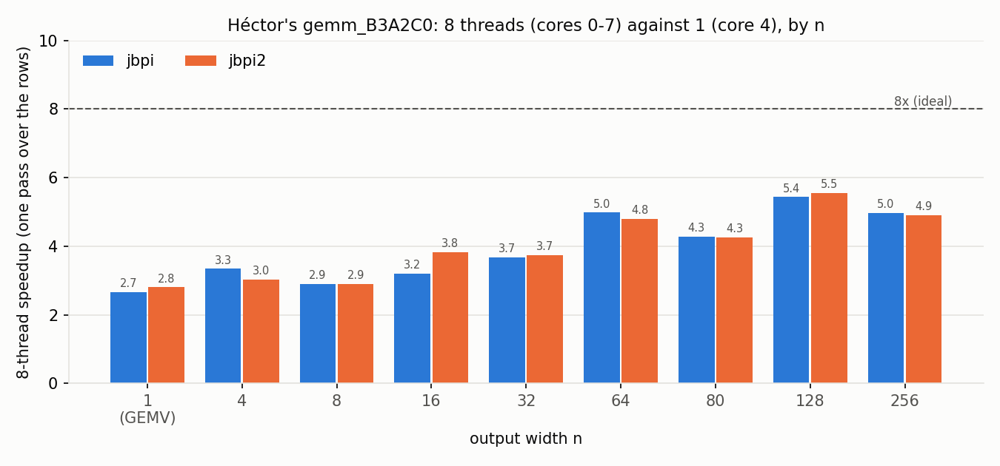
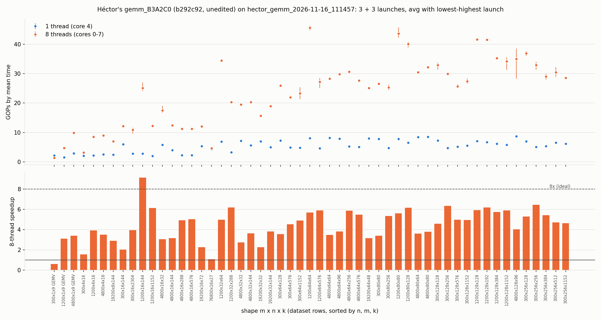
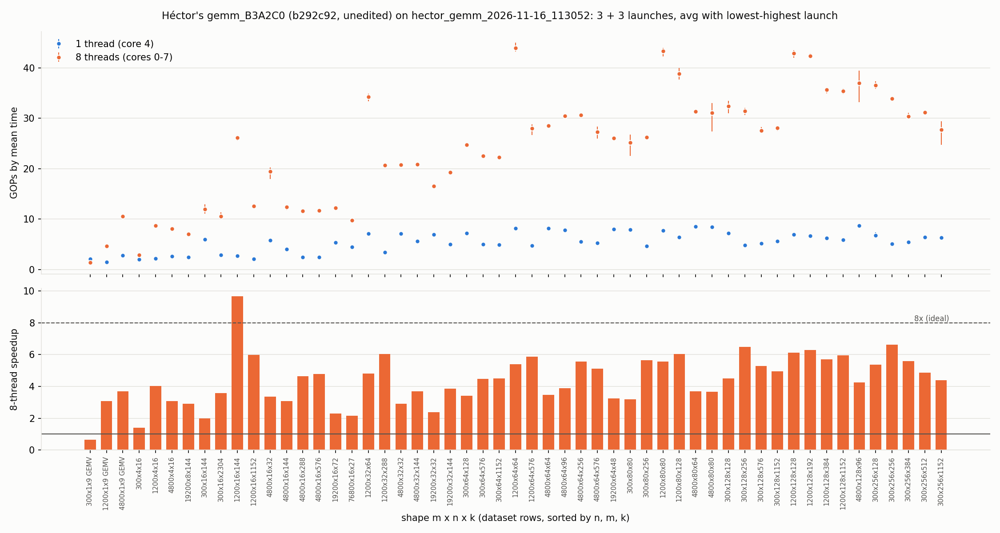

# How Héctor Martínez's GEMM Scales from One to Eight Threads on the SpacemiT K1

**Technical Report — Issue #62 (S4: read Héctor's parallel `gemm_B3A2C0` beside our macrokernel)**

| | |
|---|---|
| Project | RVV_code_gen_via_MLIR_xDSL — generated RISC-V Vector GEMM microkernels |
| Parent issue | #58 (best microkernel size per GEMM shape for Héctor Martínez's YOLO26 on the K1) |
| Covered issue | #62 (S4); hand-off to #56 (S5, the parallel design) |
| Branch | `read-hectors-parallel-gemm-b3a2c0-beside-our-macrokernel` |
| Measurement date | 16 November 2026 |
| Report date | 16 November 2026 |
| Status | Done; waiting for the user to close #62 |

---

## Abstract

Before making our own generated GEMM parallel (#56), this study reads how Héctor Martínez's GEMMLib splits a GEMM over eight threads, and measures how well that split scales on the K1. His code, at commit `b292c92` and unedited, was built with his own `Makefile` and run with his own `gemm.bin` command line on the 53 YOLO26 GEMM shapes. It ran on both boards (`jbpi`, `jbpi2`): 1 thread on core 4 and 8 threads on cores 0-7, with 3 launches per thread count in A-B-B-A order. Over one pass of the 53 shapes, 8 threads deliver **21.87 GOPs on jbpi and 23.56 GOPs on jbpi2**, against **5.10 and 5.26 GOPs** for one thread: a speedup of **4.29x and 4.48x**, about half of the ideal 8x. Scaling depends mostly on the output width n: **2.9-3.8x for n ≤ 32 and 4.3-5.6x for n ≥ 64**. His B pack gives a column slice to only 1-4 of the 8 threads when n is small, and every 256-row block ends in a barrier. The report sets his loop nest beside ours, line by line, and hands #56 a list of what to copy, change and skip.

---

## Contents

1. Introduction
2. Background
3. Method
4. Changes Made
5. Verification
6. Results
7. Discussion
8. Conclusions
9. Recommendations and Further Work
10. References
- Appendix A — Per-shape results
- Appendix B — Reproduction
- Appendix C — Files added or changed

---

## 1. Introduction

### 1.1 Context

Héctor runs YOLO26 on the K1 with his GEMMLib, using 8 threads (parent issue #58). Our generated macrokernel runs on one core. #61 found the best register tile per shape for one core; the next steps are a parallel version of our design (#56, S5) and an 8-thread tile sweep (#63, S6). Both need to know how Héctor's code splits the work, and how well that split does on this chip.

### 1.2 Aim and objectives

Aim: describe Héctor's thread split exactly, and measure it, so #56 can copy what works and avoid what does not. Objectives:

1. Set his `gemm_B3A2C0` loop nest beside our generated one, with `file:line` on both sides.
2. Build and run his code, unedited, on the board at 1 and 8 threads.
3. Answer the five questions of #62 §3, with board numbers where a question is about speed or idle threads.
4. Hand #56 a copy / change / skip list.

### 1.3 Scope

In scope: his code as he ships and runs it, 1 and 8 threads, on both boards. Out of scope (#62 §2b decision 6): changing his `#define`s (an MC sweep), 4-thread or 4 + 4 per-cluster runs, and thread pinning. These are listed as further work. None of our kernels runs inside his code, and none of his code is copied into ours.

## 2. Background

### 2.1 His loop nest

`gemm_B3A2C0` (`src/GEMM/gemm_blis.c:831-950`) is a BLIS-style five-loop GEMM: `jc` → `pc` → `ic` → `jr` → `ir`. NC = n (a single `jc` pass), KC = MC = 256 (fixed `#define`s, `gemm_blis.h:23-25`; the `YOLO_NC 512` at `:24` is not used). The fp32 register tile is 16x8, or 16x4 when n = 4. Shapes with n = 1 go to a separate GEMV (`gemv_rvv_fp32`, `:821`).

### 2.2 His thread split

One `#pragma omp parallel` covers the whole nest (`:873`), and the split is on loop 5, `ir` (`LOOP_IR`):

- **B pack:** each thread packs `its_nc * NR` columns of the shared Bc, with `its_nc = ceil(n / NR / threads)` (`:883`, `:896`), then all threads meet at a barrier (`:902`).
- **A pack:** for each 256-row `ic` block, each thread packs its own `its_mc * MR` rows into its own slice of the shared Ac (`:907`, `:919`). There is no barrier after it, because each thread reads only what it packed.
- **Compute:** each thread runs the microkernel on its own rows (`ir` from `th_id * its_mc * MR`, `:926`).
- **Barrier per `ic` block** (`:937`).
- **Fringe:** a per-thread `MR x NR` buffer (`Ctmp_th`) and a plain C add-back (`UKERNEL` macro, `:191-201`).

With MR = 16 and 8 threads, each thread gets 2 microtiles (32 rows) of each 256-row block.

### 2.3 The chip

The K1 has 8 X60 cores in two clusters of 4. Each cluster has its own L2: cores 0-3 share one and cores 4-7 the other (`/sys/devices/system/cpu/cpu*/cache/index2/shared_cpu_list`, both boards). Core 0 takes every device interrupt (house rule 1, #39).

## 3. Method

### 3.1 Workload

His `gemm_study/yolo.dat`: 53 rows (m, n, k) from one YOLO26 inference, 3 of them with n = 1 (his GEMV). Identical to `.scratch/reports/yolo26_k1_matrix_sizes.csv`.

### 3.2 Apparatus

- **Boards:** `jbpi` and `jbpi2` (BananaPi, SpacemiT K1, 8 X60 cores), reached through the jump host `fej`. Both share one NFS home.
- **Build:** his tree at `b292c92`, unedited, copied to `~/hector_gemmlib_b292c92` and built on the board with his `Makefile` and `Makefile.inc` as they are: `gcc-14 -O3 -fopenmp -march=rv64gcv_zfh_zvfh`, `NQ_FP32`, `K1`.

### 3.3 Measurement protocol

- **Command:** his `gemm.bin` command line: `TIMIN=2.0`, `TEST=T`, `ALPHA=1`, `BETA=0`, column-major, no transposes, `OMP_NUM_THREADS` = threads. No `OMP_PROC_BIND`, as he runs it.
- **Cores:**
  - 1 thread on **core 4** (his script uses core 0; house rule 1).
  - 8 threads on **cores 0-7**: core 0 is included under the user's exception to house rule 1 (16 November 2026), for 8-thread runs only.
- **Order:** 1T 8T 8T 1T 1T 8T, so 3 launches per thread count (house rule 2), one series per board.
- **Board checks:** both boards' processes are read before every launch. A launch runs only on an idle board, and the board used is read again after the launch.
- **His driver:** times calls in a loop until `TIMIN` seconds have passed and reports the mean time per call. There is no warm-up call, and his correctness check runs after the timed loop (timed loop `driver_gemm.c:186-199`, check `:201-202`).

### 3.4 Metrics

- **GOPs by mean time:** 2mnk / mean seconds per call. His driver reports no per-rep times, so "by median rep" does not exist here.
- **Per shape:** each launch's GOPs (2mnk over that launch's mean time), averaged over the 3 launches, with the lowest and highest launch. The one-pass totals instead divide total flops by the summed, launch-averaged times.
- **One pass:** the sum over shapes of the mean time (averaged over launches), and total flops over that time.
- **Speedup:** average 8-thread GOPs over average 1-thread GOPs.

The two boards are reported side by side, never averaged together.

### 3.5 Analysis

`hector_gemm_report.py` reads a series folder and writes the per-shape table, the one-pass totals and a two-panel figure. `.scratch/reports/issue-62-figs/make_figs.py` draws the by-n figure and Appendix A from the two committed series.

## 4. Changes Made

### 4.1 Design decision

His code is only read and run, never edited or copied into ours (#62 §2b decision 1). Every number in this report is his code's.

### 4.2 Additions

- `run_hector_gemm.sh`: copies, builds and runs his code with his command line, reads both boards before every launch, writes side notes for a busy board, waits while no board is idle, and stops the series on a failed launch or a failed check.
- `hector_gemm_report.py`: the report and figure.
- `hector_yolo_dump.sh` and an `--issue` flag on both YOLO runners: every series copies its report and logs to `HectorYolo/issue-<N>/` after every launch (user rule, 16 November 2026).

### 4.3 Two fixes found on the board

Both were bugs in our runner, not in his code:

1. **Parallel build.** `make -j4` linked `gemm.x` against a `libGEMM.so` that was still being written (`undefined reference to gemm_rvv`). His `gemm.x` target depends on the static library only, but `-lGEMM` picks the shared one from the same folder. The runner now builds serially, as his README says (`make`, then `make install`).
2. **Library path.** `gemm.x` NEEDs `libGEMM.so` by name. His `LD_PRELOAD` alone does not satisfy the loader (exit 127, "cannot open shared object file"). The runner adds `LD_LIBRARY_PATH=install/lib`, which points at the same file he preloads. His shell presumably already has this path.

### 4.4 Review

A two-axis review (standards, spec) found no missing or wrong requirement. From the standards side, the core-0 exception is now written into `docs/agents/execution.md` and the runner's header, and small naming and comment fixes were made. Duplicated board-reading code between the two runners was left as it is: the two use different test hooks.

## 5. Verification

- **His check:** `TEST=T` compares every row against his reference GEMM. It printed `OK` on all 53 rows of all 12 launches (no `ERROR` in any launch log).
- **Runner and report tests:** `test_run_hector_gemm.py` (6 tests) runs the runner against a stand-in board; `test_hector_gemm_report.py` (3) tests the report and figure; `test_run_yolo_sweep.py` (11) covers the dump. No test writes into the real `HectorYolo/`.
- **Full test suite:** 583 passed, 0 failed, 0 skipped (15 min 38 s). The two board-side test files ran on the board. Report: `.scratch/reports/issue-62/full_test_suite_2026-11-16.md`.
- **Board load:** no other user's job on either board before or after any launch (`side_notes.txt` empty in both series).
- **Smoke test** before the series: 2 shapes at `TIMIN=0.1` on jbpi core 4 ran and passed his check.

## 6. Results

### 6.1 Whole network

| board | 1 thread (core 4) | 8 threads (cores 0-7) | speedup |
|---|---|---|---|
| jbpi | 583.5 ms · 5.10 GOPs | 136.0 ms · 21.87 GOPs | 4.29x |
| jbpi2 | 565.2 ms · 5.26 GOPs | 126.2 ms · 23.56 GOPs | 4.48x |

One pass over the 53 shapes, mean time per call averaged over 3 launches.

### 6.2 Per output width n



| n | rows | threads with a B slice | jbpi 1T | jbpi 8T | jbpi speedup | jbpi2 1T | jbpi2 8T | jbpi2 speedup |
|---|---|---|---|---|---|---|---|---|
| 1 (his GEMV) | 3 | - | 2.43 | 6.47 | 2.66x | 2.42 | 6.78 | 2.80x |
| 4 (16x4) | 3 | 1 | 2.44 | 8.14 | 3.34x | 2.50 | 7.58 | 3.03x |
| 8 | 1 | 1 | 2.40 | 6.95 | 2.90x | 2.45 | 7.08 | 2.90x |
| 16 | 10 | 2 | 2.83 | 9.05 | 3.20x | 3.02 | 11.56 | 3.83x |
| 32 | 6 | 4 | 5.12 | 18.84 | 3.68x | 5.18 | 19.35 | 3.74x |
| 64 | 10 | 8 | 5.53 | 27.53 | 4.98x | 5.76 | 27.59 | 4.79x |
| 80 | 6 | 5 | 7.61 | 32.56 | 4.28x | 7.58 | 32.24 | 4.25x |
| 128 | 9 | 8 | 6.14 | 33.39 | 5.43x | 6.26 | 34.71 | 5.55x |
| 256 | 5 | 8 | 5.99 | 29.75 | 4.97x | 6.04 | 29.67 | 4.91x |

GOPs by mean time over the rows with that n. "Threads with a B slice" is `ceil(n / NR)` column tiles shared out `its_nc` per thread.

### 6.3 Per shape





Top panel: GOPs per shape (dot = average over launches, whisker = lowest to highest launch). Bottom panel: 8-thread speedup. Shapes are sorted by n, m, k. The full table is Appendix A.

Shapes that stand out (1T → 8T GOPs):

| shape | jbpi | jbpi2 |
|---|---|---|
| 76800x16x27 (300 `ic` blocks) | 4.29 → 4.61, 1.07x | 4.51 → 9.79, 2.17x |
| 1200x16x144 | 2.75 → 25.14, 9.14x | 2.70 → 26.14, 9.68x |
| 300x4x16 | 2.05 → 3.16, 1.54x | 2.06 → 2.92, 1.41x |
| 300x1x9 (his GEMV) | 2.13 → 1.32, 0.62x | 2.13 → 1.37, 0.64x |

### 6.4 Repeatability

- **Across launches:** the median spread between a shape's fastest and slowest launch is 2.4% (jbpi) and 2.6% (jbpi2). 74 of 106 shape-and-thread-count pairs on jbpi and 81 of 106 on jbpi2 are under 5%. Some 8-thread rows spread much more: 4800x128x96 by 36% on jbpi and 19% on jbpi2, and 300x16x2304, 300x64x1152, 4800x80x80, 300x256x1152, 300x80x80 and 300x16x144 by 17-21% on one board. The 8-thread speedups of those rows are less firm than the rest.
- **Across boards:** the one-pass totals differ by 3% at 1 thread (5.10 against 5.26 GOPs) and by 8% at 8 threads (21.87 against 23.56). The by-n speedups agree within 0.3x except n = 16 (3.20x against 3.83x). That gap comes mostly from 76800x16x27.

## 7. Discussion

### 7.1 His split beside ours

His: `src/GEMM/gemm_blis.c` @ `b292c92`. Ours: `tests/pure_xdsl_blis_rvv/generate_pure_blis_project.py` (the emitted `gemm_blis_generic`) and `templates/driver_benchmark.cpp`.

| step | his (`gemm_blis.c`) | ours |
|---|---|---|
| threads | `#pragma omp parallel` around the whole nest, `:873` | none: no OpenMP in the generator or driver |
| `jc` | `:881`, NC = n | `:553`, `nc` from the cache model (`driver_benchmark.cpp:893`; 1536 for 16x8) |
| `pc` | `:888`, KC = 256 (`gemm_blis.h:25`) | `:556`, `kc` from the cache model (256 for 16x8) |
| B pack | each thread packs `its_nc * NR` columns into a shared Bc, `:883`, `:896`; barrier `:902` | one call packs all of `cur_nc`, `:644` (the `{pack_cb_block}` template slot) |
| `ic` | `:904`, MC = 256 (`gemm_blis.h:23`) | `:648`, `mc` from the cache model (384 for 16x8) |
| A pack | each thread packs its own `its_mc * MR` rows, `:907`, `:919`; no barrier after it | one call packs all of `cur_mc`, `:654` (the `{pack_rb_block}` template slot) |
| `jr` / `ir` | `:924` / `:926`, split on `ir` | `:664` / `:667`, all tiles |
| fringe | per-thread `Ctmp_th`, `:191-201` | stack `tmp_C` per tile (pinned mode), `:623` |
| barrier per `ic` | `:937` | - |
| buffers | one `malloc` on the first call, Bc = Ac + MC*KC, `:783`, `:789` | driver allocates Ac, Bc per shape, zeroed, `driver_benchmark.cpp:928-929` |
| counters | - | `pack_time`, `kernel_time`, `*pack_bytes` through shared pointers, `:645`, `:655` |
| n = 1 | `gemv_rvv_fp32`, `:821` | the GEMM path |

### 7.2 Answers to the questions of #62 §3

1. **Where the `ir` split goes in ours, and whether each thread needs its own Ac.**
   - **Placement:** inside `gemm_blis_generic`. The B pack at `:644` splits by column slices with a barrier after it, the A pack at `:654` splits by row slices, and `ir` at `:667` starts at the thread's first row.
   - **Buffers:** one Ac is enough, as in his code, because each thread packs and reads only its own slice.
   - **Already per-thread:** our fringe buffer, since it lives on the stack.
   - **Would race:** the counters at `:645`/`:655` and the timers. They need to be per-thread, or kept on thread 0 only.
2. **MC = 256 with 8 threads.** It is a fixed `#define`, not tied to the thread count. Each thread gets 32 rows per block, and every block ends in a barrier.
   - **Many small blocks:** where blocks are many and the work per block is small, 8 threads barely help. 76800x16x27 (300 blocks, k = 27) gets 1.07x on jbpi and 2.17x on jbpi2.
   - **Partial last block:** threads sit idle there. m = 300 leaves 44 rows in its last block, so only 3 of 8 threads work.
   - **The barrier is not needed for Ac:** each thread reads only what it packed. One barrier per `pc`, before Bc is packed again, is enough.
   - **Ours:** our cache model's `mc` (384 for 16x8) is chosen for one core.
3. **The two L2 clusters.** Confirmed on both boards. His split ignores them, and no thread pinning is set. A `jr` split, an `ic` split or 4 + 4 threads per cluster were not measured (#62 §2b decision 6).
4. **Idle threads at the B pack.** Yes, for small n: 1 thread has a B slice at n = 4 or 8, 2 at n = 16, 4 at n = 32 and 5 at n = 80. The speedup by n (§6.2) follows this on both boards. Part of it is also the A side and the per-block barrier, which these runs do not separate.
5. **What his harness needs for a fair comparison (S6).**
   - **Timing:** mean time per call over a `TIMIN` loop, no warm-up, and the check outside the timed loop. This matches our reference protocol.
   - **Pinning:** none. `OMP_PROC_BIND` is unset, and `taskset` only limits the core set. His `gemm.bin` also sets `OMP_NESTEED=FALSE`, a misspelling that OpenMP ignores. It runs 1 thread on core 0.
   - **Buffers:** one `malloc` on the first call, then reused.
   - **GOPs:** from 2mnk, the same as ours.

### 7.3 Practical significance

At 8 threads his library reaches about half of the ideal speedup over the whole network. Most of the loss sits in the small-n shapes (n ≤ 32: 20 of the 50 GEMM rows), where his column split leaves most threads without B work, and in tall, thin shapes with many 256-row blocks. A parallel design for these shapes needs a different split for B, or a split that does not depend on n.

### 7.4 Limitations and threats to validity

- **Core 0 is in every 8-thread run.** Core 0 takes the device interrupts. The 8-thread numbers include that cost, and the 1-thread runs (core 4) do not.
- **No pinning.** Without `OMP_PROC_BIND`, OpenMP may place or move threads freely inside cores 0-7. This is how he runs it. Its effect on the spread and on the board-to-board gap was not tested.
- **One build, one compiler** (`gcc-14`), and his fixed blocking. Other MC/KC values were not tried.
- **Causes are not separated.** These runs time whole calls only. The roles of the B-pack split, the A-pack split and the barriers are reasoned from the code, not measured one by one.
- **`TIMIN = 2 s`** per shape, as in his script. Short shapes repeat many times; the longest repeat only a few times.
- **His first call** allocates the packing buffer inside the timed loop of the first shape (row 0, 76800x16x27). Over a 2 s window this adds little, but it is not zero.

### 7.5 Anomalies

- **76800x16x27:** the board gap (1.07x against 2.17x) is the largest of any shape. These runs do not show why.
- **1200x16x144:** above 8x on both boards. Its 1-thread run is slow (2.7 GOPs, against 5.95 for 300x16x144 with the same n and k). The cause was not measured.

## 8. Conclusions

1. Héctor's 8-thread GEMM is 4.29x (jbpi) and 4.48x (jbpi2) faster than his 1-thread one over the YOLO26 network: 21.87 and 23.56 GOPs.
2. Scaling follows n: 2.9-3.8x for n ≤ 32 and 4.3-5.6x for n ≥ 64. This matches how few threads get B work for small n.
3. His split (B by columns with one barrier, A by rows with no barrier, one shared buffer sliced by thread) maps directly onto our loop nest at `generate_pure_blis_project.py:644`, `:654` and `:667`.
4. What to avoid: the barrier per `ic` block, a B split that idles threads for small n, and an `mc` fixed without the thread count in mind.

## 9. Recommendations and Further Work

1. **For #56 (S5), copy / change / skip** (also in #56 §4):
   - **Copy:** the `ir` split with per-thread A packing; the column-sliced B pack with one barrier; one shared Ac/Bc.
   - **Change:** one barrier per `pc`, not per `ic`; a B split that keeps all threads busy for n ≤ 32; a thread-aware `mc`; per-thread counters.
   - **Skip:** fixed `#define` blocking, his GEMV path, 1 thread on core 0.
2. **Test on the board:** thread pinning (`OMP_PROC_BIND`/`OMP_PLACES`) and 4 + 4 threads per L2 cluster.
3. **Optional, on his code:** an MC sweep (needs his `#define`s changed) and 4-thread runs, to separate the barrier cost from the B-pack split.
4. **For S6 (#63):** compare our 8-thread design with his on the same cores and the same `TIMIN`, with the core-0 note on every 8-thread number.

---

## 10. References

1. F. G. Van Zee and R. A. van de Geijn, "BLIS: A Framework for Rapidly Instantiating BLAS Functionality," *ACM Transactions on Mathematical Software*, vol. 41, no. 3, 2015.
2. H. Martínez, GEMMLib_yolo, https://github.com/martineh/GEMMLib_yolo, commit `b292c92`.
3. Issue #61 report, `.scratch/reports/issue-61-report.md` (one-core tile search on the same shapes).
4. Project house rules for benchmarks, `docs/agents/execution.md` (issue #39).

---

## Appendix A — Per-shape results

GOPs by mean time, average over 3 launches per thread count. 1 thread on core 4, 8 threads on cores 0-7. Sorted by n, m, k. `row` is the row of `gemm_study/yolo.dat`.

| row | m | n | k | jbpi 1T | jbpi 8T | jbpi speedup | jbpi2 1T | jbpi2 8T | jbpi2 speedup |
|---|---|---|---|---|---|---|---|---|---|
| 35 | 300 | 1 (GEMV) | 9 | 2.13 | 1.32 | 0.62x | 2.13 | 1.37 | 0.64x |
| 21 | 1200 | 1 (GEMV) | 9 | 1.50 | 4.66 | 3.10x | 1.53 | 4.70 | 3.08x |
| 6 | 4800 | 1 (GEMV) | 9 | 2.91 | 9.88 | 3.40x | 2.86 | 10.55 | 3.69x |
| 47 | 300 | 4 | 16 | 2.05 | 3.16 | 1.54x | 2.06 | 2.92 | 1.41x |
| 30 | 1200 | 4 | 16 | 2.16 | 8.48 | 3.92x | 2.16 | 8.71 | 4.03x |
| 14 | 4800 | 4 | 16 | 2.55 | 8.95 | 3.50x | 2.65 | 8.13 | 3.07x |
| 5 | 19200 | 8 | 144 | 2.40 | 6.95 | 2.90x | 2.45 | 7.08 | 2.90x |
| 40 | 300 | 16 | 144 | 5.95 | 12.12 | 2.04x | 5.99 | 11.96 | 2.00x |
| 41 | 300 | 16 | 2304 | 2.75 | 10.86 | 3.95x | 2.94 | 10.53 | 3.58x |
| 27 | 1200 | 16 | 144 | 2.75 | 25.14 | 9.14x | 2.70 | 26.14 | 9.68x |
| 26 | 1200 | 16 | 1152 | 1.99 | 12.21 | 6.13x | 2.11 | 12.62 | 5.99x |
| 10 | 4800 | 16 | 32 | 5.74 | 17.50 | 3.05x | 5.77 | 19.44 | 3.37x |
| 8 | 4800 | 16 | 144 | 3.93 | 12.43 | 3.16x | 4.03 | 12.46 | 3.09x |
| 9 | 4800 | 16 | 288 | 2.29 | 11.26 | 4.92x | 2.50 | 11.59 | 4.65x |
| 11 | 4800 | 16 | 576 | 2.24 | 11.27 | 5.03x | 2.45 | 11.73 | 4.78x |
| 1 | 19200 | 16 | 72 | 5.34 | 12.02 | 2.25x | 5.35 | 12.28 | 2.29x |
| 0 | 76800 | 16 | 27 | 4.29 | 4.61 | 1.07x | 4.51 | 9.79 | 2.17x |
| 29 | 1200 | 32 | 64 | 6.90 | 34.40 | 4.98x | 7.15 | 34.27 | 4.80x |
| 28 | 1200 | 32 | 288 | 3.28 | 20.29 | 6.19x | 3.42 | 20.67 | 6.04x |
| 13 | 4800 | 32 | 32 | 7.12 | 19.49 | 2.74x | 7.16 | 20.81 | 2.91x |
| 12 | 4800 | 32 | 144 | 5.58 | 20.32 | 3.64x | 5.68 | 20.89 | 3.68x |
| 3 | 19200 | 32 | 32 | 6.93 | 15.66 | 2.26x | 6.94 | 16.58 | 2.39x |
| 2 | 19200 | 32 | 144 | 4.96 | 18.91 | 3.81x | 4.99 | 19.25 | 3.85x |
| 49 | 300 | 64 | 128 | 7.28 | 25.94 | 3.57x | 7.25 | 24.75 | 3.41x |
| 50 | 300 | 64 | 576 | 4.84 | 21.91 | 4.52x | 5.04 | 22.53 | 4.47x |
| 48 | 300 | 64 | 1152 | 4.76 | 23.31 | 4.89x | 4.94 | 22.27 | 4.50x |
| 32 | 1200 | 64 | 64 | 8.03 | 45.59 | 5.68x | 8.17 | 43.99 | 5.38x |
| 31 | 1200 | 64 | 576 | 4.61 | 27.16 | 5.89x | 4.77 | 27.98 | 5.86x |
| 17 | 4800 | 64 | 64 | 8.14 | 28.28 | 3.47x | 8.23 | 28.53 | 3.47x |
| 18 | 4800 | 64 | 96 | 7.83 | 29.85 | 3.81x | 7.86 | 30.45 | 3.88x |
| 15 | 4800 | 64 | 256 | 5.23 | 30.68 | 5.87x | 5.50 | 30.69 | 5.58x |
| 16 | 4800 | 64 | 576 | 5.05 | 27.64 | 5.47x | 5.32 | 27.28 | 5.12x |
| 4 | 19200 | 64 | 48 | 7.96 | 25.10 | 3.15x | 8.03 | 26.03 | 3.24x |
| 52 | 300 | 80 | 80 | 7.79 | 26.54 | 3.41x | 7.90 | 25.20 | 3.19x |
| 51 | 300 | 80 | 256 | 4.74 | 25.27 | 5.33x | 4.64 | 26.21 | 5.64x |
| 34 | 1200 | 80 | 80 | 7.80 | 43.63 | 5.59x | 7.78 | 43.31 | 5.57x |
| 33 | 1200 | 80 | 128 | 6.50 | 40.09 | 6.17x | 6.44 | 38.84 | 6.03x |
| 19 | 4800 | 80 | 64 | 8.45 | 30.49 | 3.61x | 8.50 | 31.34 | 3.69x |
| 20 | 4800 | 80 | 80 | 8.48 | 32.20 | 3.80x | 8.46 | 31.11 | 3.68x |
| 37 | 300 | 128 | 128 | 7.19 | 32.89 | 4.57x | 7.22 | 32.45 | 4.50x |
| 38 | 300 | 128 | 256 | 4.73 | 29.95 | 6.33x | 4.84 | 31.45 | 6.50x |
| 39 | 300 | 128 | 576 | 5.14 | 25.64 | 4.99x | 5.22 | 27.61 | 5.29x |
| 36 | 300 | 128 | 1152 | 5.53 | 27.39 | 4.95x | 5.68 | 28.09 | 4.95x |
| 23 | 1200 | 128 | 128 | 7.04 | 41.64 | 5.91x | 7.00 | 42.87 | 6.12x |
| 24 | 1200 | 128 | 192 | 6.72 | 41.54 | 6.18x | 6.73 | 42.41 | 6.30x |
| 25 | 1200 | 128 | 384 | 6.15 | 35.29 | 5.74x | 6.26 | 35.64 | 5.69x |
| 22 | 1200 | 128 | 1152 | 5.79 | 34.13 | 5.90x | 5.94 | 35.41 | 5.96x |
| 7 | 4800 | 128 | 96 | 8.68 | 35.01 | 4.03x | 8.69 | 37.03 | 4.26x |
| 43 | 300 | 256 | 128 | 6.99 | 36.89 | 5.28x | 6.81 | 36.56 | 5.37x |
| 44 | 300 | 256 | 256 | 5.10 | 32.90 | 6.46x | 5.11 | 33.90 | 6.63x |
| 45 | 300 | 256 | 384 | 5.34 | 28.99 | 5.43x | 5.44 | 30.39 | 5.59x |
| 46 | 300 | 256 | 512 | 6.48 | 30.50 | 4.71x | 6.40 | 31.15 | 4.86x |
| 42 | 300 | 256 | 1152 | 6.17 | 28.52 | 4.62x | 6.31 | 27.71 | 4.39x |

## Appendix B — Reproduction

```bash
# clone his code at the measured commit (read-only)
git clone https://github.com/martineh/GEMMLib_yolo <clone> && git -C <clone> checkout b292c92

# one series per board: build, then 1T 8T 8T 1T 1T 8T; report and figure; copy to .scratch/reports/issue-62/
setsid nohup ./tests/pure_xdsl_blis_rvv/run_hector_gemm.sh --src <clone> --boards jbpi \
    > tests/pure_xdsl_blis_rvv/logs/hector_gemm.out 2>&1 < /dev/null &
setsid nohup ./tests/pure_xdsl_blis_rvv/run_hector_gemm.sh --src <clone> --boards jbpi2 \
    > tests/pure_xdsl_blis_rvv/logs/hector_gemm_jbpi2.out 2>&1 < /dev/null &   # after the first ends: one shared build folder

# report and figure for a series; the by-n figure and Appendix A
python tests/pure_xdsl_blis_rvv/hector_gemm_report.py <series folder> -o report.md --plot fig.png
python .scratch/reports/issue-62-figs/make_figs.py
```

Committed logs: `tests/pure_xdsl_blis_rvv/logs/hector_gemm_2026-11-16_111457/` (jbpi) and `hector_gemm_2026-11-16_113052/` (jbpi2): plan, runs, his console table and CSV per launch, build log, board reads, side notes, console output, report and figure. Copies: `.scratch/reports/issue-62/`.

## Appendix C — Files added or changed

| File | Change |
|---|---|
| `tests/pure_xdsl_blis_rvv/run_hector_gemm.sh` | new, 201 lines |
| `tests/pure_xdsl_blis_rvv/test_run_hector_gemm.py` | new, 6 tests |
| `tests/pure_xdsl_blis_rvv/hector_gemm_report.py` | new, 157 lines |
| `tests/pure_xdsl_blis_rvv/test_hector_gemm_report.py` | new, 3 tests |
| `tests/pure_xdsl_blis_rvv/hector_yolo_dump.sh` | new, 9 lines (also on branch `yolo-runs-dump-report-into-hectoryolo-per-issue`) |
| `tests/pure_xdsl_blis_rvv/run_yolo_sweep.sh`, `test_run_yolo_sweep.py` | `--issue`, report and dump after every launch; 2 new tests |
| `docs/agents/execution.md` | the runner's entry, with the core-0 exception; the sweep's dump |
| `.scratch/issues/0045` (#62), `0040` (#56), `0044` (#61) | results and closure; copy / change / skip list; moved-copy path |
| `.scratch/reports/issue-62-report.md`, `issue-62-figs/` | this report, its figures and their script |
| `.scratch/reports/issue-62/` | README, both series, test report, this report |
