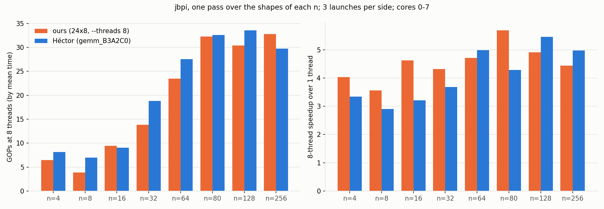
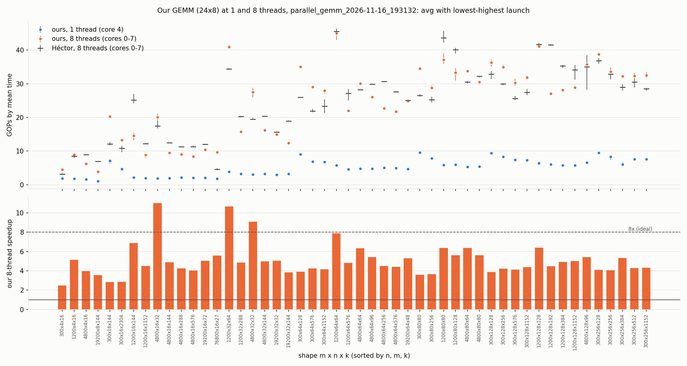

# Issue #56: our parallel GEMM on the board (2026-11-16)

GitHub: https://github.com/JieGH/RVV_code_gen_via_MLIR_xDSL/issues/56 · **engineering report: [`report/issue-56-report.md`](report/issue-56-report.md)** · issue write-up: `.scratch/issues/0040-parallel-gemm-design.md` §5-§7.

**What ran:** our design with the new `--threads N` (OpenMP), tile 24x8 (#61's best single tile), on the 50 YOLO26 shapes of `datasets/yolo26_k1.dat` (Héctor's 53 rows without the three n = 1 rows). Board **jbpi**, uninstrumented (`INSTRUMENTED=0`), reference protocol, `--tmin 2`, `--no-nc-overrides`, vector packer. 1 thread on **core 4**; 8 threads on **cores 0-7** (`OMP_PROC_BIND=close OMP_PLACES=cores`; core 0 included by the user's exception for 8-thread runs). Order 1T 8T 8T 1T 1T 8T: 3 launches per thread count, 19:31-20:00. **Every row checked against the scalar oracle: 50 of 50 PASS in all 6 launches.** No other user's job on the board before or after any launch.

**Héctor's numbers** are his #62 jbpi series ([`../issue-62/hector_gemm_2026-11-16_111457/`](../issue-62/hector_gemm_2026-11-16_111457/hector_gemm_report.md)): same board, same cores, his `gemm.bin` with `TIMIN=2.0`, run 8 hours earlier, not interleaved with ours. His driver gives the mean time only.

## One pass over the 50 shapes

| | 1 thread (core 4) | 8 threads (cores 0-7) | speedup |
|---|---|---|---|
| ours, by mean time | 698.6 ms · 4.26 GOPs | 152.1 ms · 19.55 GOPs | 4.59x |
| ours, by median rep | 698.2 ms · 4.26 GOPs | 148.3 ms · 20.05 GOPs | 4.71x |
| Héctor, by mean time | 583.3 ms · 5.10 GOPs | 135.7 ms · 21.91 GOPs | 4.30x |

Our 8-thread GOPs by mean time match or beat his on **25 of 50** shapes.

## By n (GOPs by mean time, one pass over the shapes with that n)

| n | shapes | ours 1T | ours 8T | ours speedup | Héctor 1T | Héctor 8T | Héctor speedup |
|---|---|---|---|---|---|---|---|
| 4 | 3 | 1.61 | 6.49 | 4.03x | 2.44 | 8.15 | 3.34x |
| 8 | 1 | 1.09 | 3.87 | 3.56x | 2.40 | 6.95 | 2.90x |
| 16 | 10 | 2.05 | 9.47 | 4.62x | 2.83 | 9.06 | 3.21x |
| 32 | 6 | 3.20 | 13.82 | 4.32x | 5.12 | 18.84 | 3.68x |
| 64 | 10 | 4.98 | 23.46 | 4.71x | 5.53 | 27.54 | 4.98x |
| 80 | 6 | 5.68 | 32.30 | 5.68x | 7.61 | 32.57 | 4.28x |
| 128 | 9 | 6.20 | 30.43 | 4.91x | 6.14 | 33.54 | 5.46x |
| 256 | 5 | 7.40 | 32.82 | 4.44x | 5.99 | 29.77 | 4.97x |

- n ≤ 32: we scale better (3.6-4.6x against his 2.9-3.7x), but start from a slower 1 thread, so his 8 threads stay ahead except at n = 16.
- n ≥ 64: our 8 threads are level with his at n = 80, behind at 64 and 128, ahead at 256.

## Figures

Per shape (dot = average over launches, whisker = lowest to highest launch; bottom: our 8-thread speedup):

## In the series folder [`parallel_gemm_2026-11-16_193132/`](parallel_gemm_2026-11-16_193132/parallel_gemm_report.md)

`parallel_gemm_report.md` (per-shape table: both GOPs metrics, spread, Héctor beside), `parallel_gemm_fig.png`, `plan.txt`, `runs.tsv`, `L<n>_T<threads>_jbpi.log` (console per launch), `load_jbpi_L<n>{,_after}.txt` (the board's processes before and after every launch). The run folders (`provenance.txt` with `threads`, per-rep logs) are in `tests/pure_xdsl_blis_rvv/logs/run_2026-11-16_{193618,194037,194504,194944,195424,195855}/`.

## Tests

Full test suite on the #56 branch: **604 passed, 0 failed, 0 skipped**. Report: [`full_test_suite_2026-11-16.md`](full_test_suite_2026-11-16.md).

Rebuild the report: `python tests/pure_xdsl_blis_rvv/parallel_gemm_report.py tests/pure_xdsl_blis_rvv/logs/parallel_gemm_2026-11-16_193132 --hector HectorYolo/issue-62/hector_gemm_2026-11-16_111457 -o report.md --plot fig.png`.
