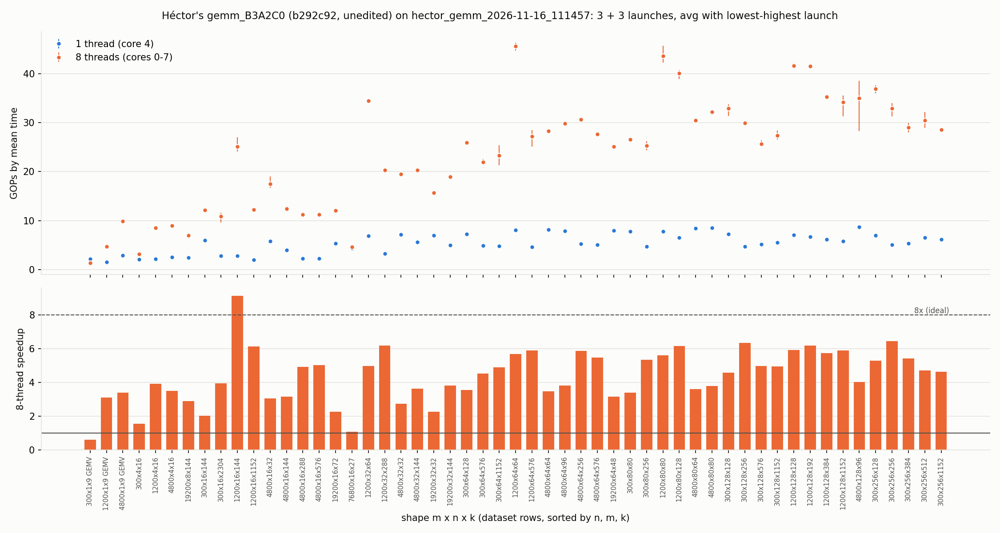
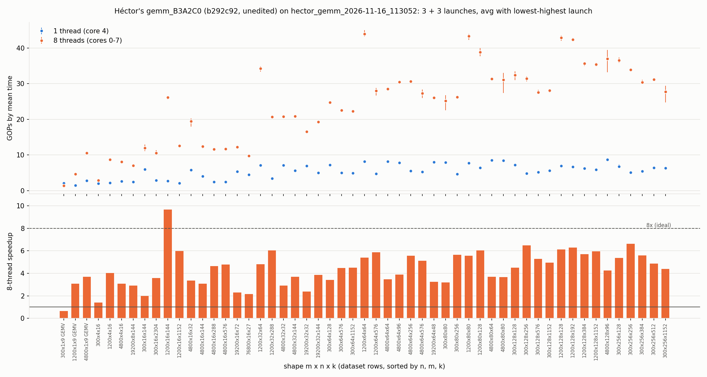

# Issue #62: Héctor's parallel GEMM on the board (2026-11-16)

GitHub: https://github.com/JieGH/RVV_code_gen_via_MLIR_xDSL/issues/62 · full write-up: `.scratch/issues/0045-read-hector-parallel-gemm.md` §6.

**What ran:** Héctor's GEMMLib_yolo at commit `b292c92`, **unedited**, built on the board with his `Makefile` (`gcc-14 -O3 -fopenmp`, `NQ_FP32`, `K1`). His `gemm.bin` command line: `TIMIN=2.0`, `TEST=T`, `gemm_study/yolo.dat` (53 YOLO26 shapes). 1 thread on **core 4**; 8 threads on **cores 0-7** (core 0 included: the user's exception for 8-thread runs only). No `OMP_PROC_BIND`, as he runs it. Order 1T 8T 8T 1T 1T 8T: 3 launches per thread count, one series per board. His check printed `OK` on every row of every launch. Neither board had another user's job before or after any launch.

**Metric:** GOPs by mean time (`2mnk` / mean seconds per call). His driver reports only the mean, so there is no "by median rep". The boards are shown side by side, never averaged together.

## One pass over the 53 shapes

| board | folder | 1 thread (core 4) | 8 threads (cores 0-7) | speedup |
|---|---|---|---|---|
| jbpi | [`hector_gemm_2026-11-16_111457/`](hector_gemm_2026-11-16_111457/hector_gemm_report.md) | 583.5 ms · 5.10 GOPs | 136.0 ms · 21.87 GOPs | 4.29x |
| jbpi2 | [`hector_gemm_2026-11-16_113052/`](hector_gemm_2026-11-16_113052/hector_gemm_report.md) | 565.2 ms · 5.26 GOPs | 126.2 ms · 23.56 GOPs | 4.48x |

## By `n` (one pass over the rows with that `n`)

| n | rows | jbpi 1T | jbpi 8T | jbpi speedup | jbpi2 1T | jbpi2 8T | jbpi2 speedup |
|---|---|---|---|---|---|---|---|
| 1 (his GEMV) | 3 | 2.43 | 6.47 | 2.66x | 2.42 | 6.78 | 2.80x |
| 4 | 3 | 2.44 | 8.14 | 3.34x | 2.50 | 7.58 | 3.03x |
| 8 | 1 | 2.40 | 6.95 | 2.90x | 2.45 | 7.08 | 2.90x |
| 16 | 10 | 2.83 | 9.05 | 3.20x | 3.02 | 11.56 | 3.83x |
| 32 | 6 | 5.12 | 18.84 | 3.68x | 5.18 | 19.35 | 3.74x |
| 64 | 10 | 5.53 | 27.53 | 4.98x | 5.76 | 27.59 | 4.79x |
| 80 | 6 | 7.61 | 32.56 | 4.28x | 7.58 | 32.24 | 4.25x |
| 128 | 9 | 6.14 | 33.39 | 5.43x | 6.26 | 34.71 | 5.55x |
| 256 | 5 | 5.99 | 29.75 | 4.97x | 6.04 | 29.67 | 4.91x |

Small `n` scales worst. His B pack gives a column slice to only some threads: 1 at n = 4 or 8, 2 at n = 16, 4 at n = 32, all 8 from n = 64.

Single shapes worth a look (1T → 8T GOPs, speedup):

| shape | jbpi | jbpi2 |
|---|---|---|
| 76800x16x27 (300 `ic` blocks, a barrier each) | 4.29 → 4.61, 1.07x | 4.51 → 9.79, 2.17x |
| 1200x16x144 | 2.75 → 25.14, 9.14x | 2.70 → 26.14, 9.68x |
| 300x1x9 (his GEMV) | 2.13 → 1.32, 0.62x | 2.13 → 1.37, 0.64x |

76800x16x27 differs most between the boards (1.07x against 2.17x); these runs do not show why. 1200x16x144 goes above 8x because its 1-thread run is slow (2.7 GOPs); the cause was not measured.

## Figures

Each panel's x axis is the 53 shapes, sorted by `n`, `m`, `k`. Top: GOPs at 1 and 8 threads (dot = average over launches, whisker = lowest to highest launch). Bottom: 8-thread speedup, with the ideal 8x dashed.

**jbpi**

**jbpi2**

## In each folder

`hector_gemm_report.md` (per-shape table), `hector_gemm_fig.png`, `plan.txt`, `runs.tsv`, `L<n>_T<threads>_<board>.{log,csv}` (his console table and CSV per launch), `build.log`, `load_*.txt` (both boards' processes before and after every launch), `side_notes.txt` (busy boards: none), `console.out`.

Rebuild a report: `python tests/pure_xdsl_blis_rvv/hector_gemm_report.py <series folder> -o report.md --plot fig.png`.
