# Goal: Replicate and Replace Legacy BLIS Benchmark with Pure xDSL

This plan outlines the strategy to fully replace your old benchmarking methodology (relying on `.ext/RVV_ukernels_benchmark` and manual remote file replacement) with a modern, end-to-end xDSL-driven benchmark suite in `tests/pure_xdsl_blis_rvv`.

---

## The Strategy: The "Project Generator" Paradigm

Instead of manually maintaining a static C++ project and just injecting generated C files into it, we shift to a **highly scalable Project Generator paradigm**.

Your local Python/xDSL framework will act as a **factory**. Based on the configuration you provide (datatype, packing method, VLEN, cache config MC/NC/KC), the script generates an **entire, self-contained benchmarking project directory**. This directory will contain the generated xDSL C code for an **entire family** of micro-kernel dimensions (e.g., MR4_NR4, MR4_NR8, MR8_NR8, etc.), the benchmark driver, and a `Makefile`.

**A single project = one datatype + one packing method + all MR/NR kernel family variants + one VLEN.**

This entire generated directory is then synced to the remote RISC-V machine. The remote user simply runs `make all` to build and execute all variants in the family.

---

## Key Design Decisions

### 1. Project = Kernel Family (not a single kernel)
A generated project is not for one kernel size. It is for a **family** of micro-kernel dimensions sharing the same:
- `--datatype` (e.g., `fp32`, `int8`)
- `--method` (packing layout, e.g., `AXPY_FP32_Pack`, `DOT_INT8_LANE`)
- `--vlen` (hardware vector length, e.g., 256, 512)
- Cache config (MC, NC, KC)

The generator will iterate over all MR/NR pairs in the defined family (e.g., `[(4,4), (4,8), (8,8), (8,16)]`) and emit a separate C source for each, compiled into one benchmark binary that tests all of them.

**Generated directory example:**
```
tests/pure_xdsl_blis_rvv/pj_gen/fp32_AXPY_vlen256/
├── gemm_full_xdsl_MR4_NR4.c    # xDSL generated
├── gemm_full_xdsl_MR4_NR8.c    # xDSL generated
├── gemm_full_xdsl_MR8_NR8.c    # xDSL generated
├── gemm_full_xdsl_MR8_NR16.c   # xDSL generated
├── driver_benchmark.cpp         # Benchmark harness (all kernels)
├── Makefile                     # Standalone, no host-side deps
└── datasets/                    # Symlink or copy of cnn_models
    └── bert_large.dat, square.dat, ...
```

### 2. VLEN Awareness
VLEN is a hardware-specific property of the RISC-V board (jbpi2). The plan handles this in two phases:
- **Generation time (host):** The user explicitly passes `--vlen 256` (or `512`) as a CLI argument. This is used to parameterize the xDSL builder to emit the correct `vsetvli` instructions and compute derived register tiling (e.g., how many FP32 values fit in a vector register).
- **Runtime validation (board):** The generated `Makefile` will include a pre-flight check that queries the board's actual VLEN (via an inline `vsetvlmax` C snippet) and asserts it matches the compiled-in value. This prevents silent correctness bugs when deploying to a board with a different VLEN than expected.

### 3. Datatype Handling in Driver
The `driver_benchmark.cpp` is **not** string-templated. Instead, it uses compile-time `#ifdef` guards:
```cpp
#ifdef DTYPE_FP32
  using scalar_t = float;
#elif DTYPE_INT8
  using scalar_t = int8_t;
#endif
```
The Makefile passes `-DDTYPE_FP32` (or `-DDTYPE_INT8`) based on the configuration. This keeps the driver a single clean C++ file with no Python string munging.

### 4. `cnn_models` Dataset Files (Universal Strategy)
The `cnn_models` dataset files (e.g., `bert_large.dat`, `square.dat`) are the pre-existing files from the legacy suite.
- They are stored permanently in a universal, shared directory at `tests/pure_xdsl_blis_rvv/datasets/`.
- The `generate_pure_blis_project.py` script **does not** duplicate them per-project.
- The `compile_macro_bench.sh` orchestrator script explicitly rsyncs this universal `datasets/` folder over to the board alongside the generated project directory.
- The user can dynamically select which datasets to benchmark via the `"datasets"` array in `config.json` (e.g., `"datasets": ["square.dat"]`).

---

## Implementation Steps (Detailed Specifications)

### Step 0: Define the Configuration Schema & Analytical Model
Before any code is written, formalize the configuration as a Python `dataclass` or YAML config file consumed by the generator. 

**Dynamic Cache Parameter Calculation (Python `model_level`):**
Instead of the user guessing `MC`, `NC`, and `KC`, or forcing the C++ driver to compute them at runtime, we will **port your C analytical model (`model_level.c`) into Python**. 
The configuration schema will take an `arch` name (e.g., `jbpi2`). The Python generator will load the cache parameters (NL, CL, WL) for that architecture, and run the Python version of `model_level()` to dynamically compute the optimal `MC`, `NC`, and `KC` for each `(MR, NR)` pair at generation time. This gives the MLIR compiler the exact hardware-optimized constants it needs to maximize performance!

```python
@dataclass
class BLISProjectConfig:
    datatype: str        # "fp32" | "int8"
    method: str          # "AXPY_FP32_Pack" | "DOT_INT8_LANE" | ...
    vlen: int            # 256 | 512
    arch: str            # "jbpi2" | "generic_rvv" (points to cache configs)
    mr_nr_family: list   # e.g. [(4,4), (4,8), (8,8), (8,16)]
```
The generator uses this config to produce a consistently named output directory.

**Verification for Step 0:** Run the python script locally (e.g., `python3 cache_config.py`) to confirm that the dynamically calculated `MC`, `NC`, and `KC` outputs perfectly match the legacy `.ext/RVV_ukernels_benchmark/gemm_blis_family/modelLevel/model_test.c` output.

### Step 1: Create the Unified Project Generator (`generate_pure_blis_project.py`)
A master Python script that, for a given `BLISProjectConfig`, generates the full project:
1. **Determine output directory name** from config: `pj_gen/{datatype}_{method}_vlen{vlen}/`
2. **For each `(MR, NR)` pair** in `mr_nr_family`:
   - Compute optimal `MC, NC, KC` via the Python `model_level` analytical model for the given `arch`.
   - Call xDSL micro-kernel builder → generate micro-kernel MLIR for that dimension.
   - Call `macro_builder.py` with optimal MC, NC, KC, MR, NR → generate macro-kernel MLIR.
   - Call `pack_builder.py` with method, vlen, datatype → generate packing MLIR.
   - **Module Merging:** Merge the micro-kernel, macro-kernel, AND packing MLIR into a single module. We will carefully manage all function names (e.g., prefixing/suffixing micro, macro, and pack functions with `_MRx_NRy`) to prevent any collisions, as the packing logic depends on the specific `MC, NC, KC, MR, NR` of that iteration.
   - Lower the combined module to C → emit `gemm_full_xdsl_MRx_NRy.c`.
3. **Generate C++ Header:** Emit a `generated_kernels.h` file containing the C prototypes for all generated kernel variants and their cache config accessors. Because the remote project is static and updated entirely by the host, generating this header locally avoids any runtime dependencies or manual driver updates.
4. **Copy static files** into the directory: `driver_benchmark.cpp` (which includes `generated_kernels.h`), `Makefile` (templated with correct `-D` flags), dataset files from `cnn_models`.

**CRITICAL RULE (Paths):** The generator must accept a `--mlir-translate` parameter and default it to `/home/jlei/Documents/ws_MLIR/llvm_pj_dir_06092025/llvm-project/build/bin/mlir-translate`, exactly matching how `test_codeGeneration.py` does it.

**Verification for Step 1:** Execute `python3 generate_pure_blis_project.py --config fp32_axpy_config.json` locally and manually inspect `pj_gen/.../gemm_full_xdsl_MRx_NRy.c` and `generated_kernels.h` to ensure MLIR modules merged cleanly with no naming collisions.

### Step 2: Define the C++ Benchmark Driver (`driver_benchmark.cpp`)
A single, static C++ file (not generated, not templated by Python — just copied into `pj_gen/`).
1. **Datatype switching:** Uses `#ifdef DTYPE_FP32 / DTYPE_INT8` compile-time guards.
2. **Kernel dispatch:** `#include "generated_kernels.h"` to gain access to all the generated functions. It maps kernel names to the generated function pointers, ensuring the remote driver can test all variants without manual C++ modifications.
3. **Memory Setup:** Allocates aligned buffers for A, B, C and initializes with random data.
4. **Correctness Check:** Runs a scalar baseline GEMM to verify each kernel variant (`test == 'T'`).
5. **Timing Loop:** For each kernel and each `(M, N, K)` from `cnn_models`, measures wall-clock time over multiple iterations and computes GFLOPS.
6. **Output:** Writes legacy semicolon-delimited CSV (`M;N;K;GFLOPS;...`) per kernel to `results_{kernel}.csv`. This ensures your existing `plot_perf.py` and `plot_comparison.py` scripts work without modification.

**Verification for Step 2:** Perform a test compilation of `driver_benchmark.cpp` alongside the generated C code on the RISC-V board to ensure it resolves all symbols defined in `generated_kernels.h`.

### Step 3: Define the Standalone `Makefile`
The Makefile deposited in `pj_gen/` must be fully self-contained with no host-side dependencies:
1. **Cross-compilation target:** `riscv64-linux-gnu-g++ -march=rv64gcv -O3 -DDTYPE_FP32`
2. **All kernel C files:** `SRCS = gemm_full_xdsl_MR4_NR4.c gemm_full_xdsl_MR8_NR8.c ...` (auto-listed by the generator).
3. **VLEN assertion target:** A `make check_vlen` target that compiles a tiny probe binary and asserts `vsetvlmax == expected_vlen` before running the benchmark.
4. **Run target:** `make run` compiles + runs the binary against all `datasets/*.dat` files.

**Verification for Step 3:** Manually transfer the `pj_gen` directory to the remote board, run `make check_vlen && make all`, and verify the final binary executes and produces the expected CSV files.

### Step 4: Develop the Remote Sweep Script (`compile_macro_bench.sh`)
A bash orchestrator modeled on `compile.sh`, with the heavy lifting already done by the generator:
1. **Parse args:** `--config my_config.yaml --remote-user jlei --remote-host jbpi2 --remote-port 22 --jump ... --mlir-translate ...`
2. **Local Generation:** Call `generate_pure_blis_project.py` with the chosen config, properly passing `--mlir-translate` and executing within the `.venv` of the `repo_xdsl_microkernels` project.
3. **VLEN sync:** Optionally query the remote board's actual VLEN via `ssh_board "cat /sys/devices/virtual/riscv_isa"` and warn/abort if it mismatches the config.
4. **Directory Sync:** Rsync the **entire** `pj_gen/{config_name}/` directory to `RISCV_WORKSPACE` on the board. The SSH setup and rsync logic MUST strictly follow the exact SSH `-J` proxy jumping and port forwarding rules defined in your old `compile.sh`.
5. **Remote Compilation:** SSH into the board, `cd` into the synced directory, and run `make check_vlen && make all`.
6. **Execution Sweep:** Run `make run`, which internally loops over all `datasets/*.dat` files.
7. **Fetch & Plot:** Rsync `results_*.csv` back to the local machine, then call `plot_perf.py` and `plot_comparison.py` automatically.

**Verification for Step 4:** Execute the orchestrator script from the host (`./compile_macro_bench.sh --config ...`). Verify it completes the end-to-end flow without human intervention (generation -> sync -> compile -> run -> fetch).

### Step 5: Verification and Switchover
1. Run the orchestrator against a small test configuration (`MR4_NR4` only, `square.dat`).
2. Compare the output CSVs and GFLOPS numbers against the legacy `.ext/RVV_ukernels_benchmark` outputs within ±5% tolerance.
3. Verify correctness logs show zero mismatches.
4. Add `pj_gen/` to `.gitignore` so generated projects are never committed.
5. Once verified, fully deprecate the legacy benchmarking flow.

**Verification for Step 5:** Run the python plotting tools against the newly generated CSVs and verify the GFLOPS numbers match or exceed the legacy `.ext` benchmarks within ±5%.

---

## Final Execution Command
To run the full end-to-end pipeline (generation, sync, compilation, and execution) using the generic configuration file, simply run:

```bash
REMOTE_PASS="" REMOTE_HOST="fej" REMOTE_PORT="3322" ./tests/pure_xdsl_blis_rvv/compile_macro_bench.sh \
    --jump \
    --riscv-user jlei --riscv-ip jbpi2 --riscv-port 22
```
(No `--config` parameter is required, as the orchestrator now uses `config.json` by default).

---

## Execution Updates & Fixes
During implementation, several robust modifications were made to ensure stability and cleanliness:
1. **Generic Configuration:** The configuration file was unified to `config.json` instead of being datatype/packing dependent (e.g., `fp32_axpy_config.json`).
2. **Dataset Configuration:** The JSON schema was extended to parse an optional `"datasets"` array, allowing users to strictly test a specific subset of `.dat` files without manual Makefile editing.
3. **Aligned Memory Allocation:** RISC-V Vector Extensions (`jbpi2`) can trigger Hardware Bus Errors / Segfaults on unaligned vector memory access. The `driver_benchmark.cpp` memory allocations were upgraded from standard C++ `std::vector` to strict `aligned_alloc(64, ...)` to guarantee optimal hardware execution alignment.
4. **C++ Signature Wrapper:** A Python-injected C++ wrapper bridges the gap between the BLIS macro-kernel invocation signature (expecting `int32_t`) and the RISC-V micro-kernel generated signatures (expecting `size_t` pointers).
5. **Universal Datasets:** Dataset duplication in project generation was completely removed in favor of a universal `datasets/` folder explicitly synced via the bash orchestrator.

---

## Incremental Development Plan

To ensure a smooth, testable development process, we will execute the above steps in **incremental steps**. Each step is fully testable before moving to the next.

### Step 1.1: The Unified MLIR Merger (Python)
**Goal:** Prove we can generate a single `.c` file containing both the micro-kernel and macro-kernel without naming collisions.
1. Create `tests/pure_xdsl_blis_rvv/generate_pure_blis_project.py`.
2. Hardcode a simple configuration (e.g., `fp32`, `MR=4`, `NR=4`).
3. Import `test_codeGeneration.py` to generate the micro-kernel MLIR.
4. Import `macro_builder.py` to generate the macro-kernel MLIR.
5. Apply a renaming pass to ensure function names are suffixed with `_MR4_NR4` to prevent collisions.
6. Merge both into a single `builtin.ModuleOp` and lower to C.
**Verification:** Run the script locally and manually inspect the output `.c` file to ensure both the ukernel and macro loops are present and correctly named.

### Step 1.2: Project Scaffold & Header Generation
**Goal:** Expand the script to handle a *family* of kernels and emit a valid C project directory.
1. Implement the `BLISProjectConfig` dataclass/YAML parser.
2. Add a loop in the generator to iterate over the `mr_nr_family` list (e.g., `[(4,4), (8,8)]`).
3. Create the `pj_gen/{config_name}/` directory structure.
4. Emit multiple `gemm_full_xdsl_MRx_NRy.c` files into the directory.
5. Generate `generated_kernels.h`, which contains the C prototypes and a `std::map` or array mapping string names (e.g., `"MR4_NR4"`) to function pointers.
**Verification:** Run the script and verify the directory is created, populated with the `.c` files, and the `.h` file is syntactically valid C++.

### Step 1.3: The Static Driver & Makefile
**Goal:** Build the static execution scaffolding so the generated C code can be compiled and run.
1. Create a `templates/` folder in `tests/pure_xdsl_blis_rvv/`.
2. Write `driver_benchmark.cpp` inside `templates/`. Implement the memory allocation, scalar reference check, and the timing loop over the kernels defined in `generated_kernels.h`.
3. Write a standalone `Makefile` inside `templates/`.
4. Update `generate_pure_blis_project.py` to copy the driver and Makefile from `templates/` into the `pj_gen/` output folder during generation.
5. Link or copy the `cnn_models` dataset files into the `pj_gen/` folder.
**Verification:** Manually copy the `pj_gen/` folder to the RISC-V board, run `make all` and `./test_gemm.x`, and verify it outputs CSV data to stdout or a file.

### Step 1.4: The Remote Orchestrator
**Goal:** Automate the entire workflow from generation to remote execution.
1. Create `compile_macro_bench.sh`.
2. Implement argument parsing (remote IP, user, port, config file).
3. Call `generate_pure_blis_project.py`.
4. Add the `rsync` logic to push the `pj_gen/` directory to `RISCV_WORKSPACE`.
5. Add the `ssh` logic to remotely execute `make check_vlen`, `make all`, and `make run`.
**Verification:** Run `./compile_macro_bench.sh --config test.yaml` from the host and watch it automatically generate, sync, compile, and run on the remote board.

### Step 1.5: Plotting & Pipeline Verification
**Goal:** Ensure the output formats perfectly match the legacy analysis tools.
1. Have the orchestrator rsync the resulting `results_*.csv` files back to the host.
2. Run your existing `plot_perf.py` and `plot_comparison.py` on the pulled CSVs.
3. Compare the GFLOPS numbers against the old `.ext/RVV_ukernels_benchmark` to ensure performance hasn't regressed.
4. Fully deprecate the legacy flow.

---

## Architecture Diagram

```mermaid
graph TD
    classDef generator fill:#1f77b4,stroke:#fff,stroke-width:2px,color:#fff;
    classDef output fill:#2ca02c,stroke:#fff,stroke-width:2px,color:#fff;
    classDef orchestrator fill:#ff7f0e,stroke:#fff,stroke-width:2px,color:#fff;
    classDef target fill:#d62728,stroke:#fff,stroke-width:2px,color:#fff;
    classDef plot fill:#9467bd,stroke:#fff,stroke-width:2px,color:#fff;
    classDef config fill:#8c564b,stroke:#fff,stroke-width:2px,color:#fff;

    subgraph Host["1. Host Machine: Project Generation"]
        CFG[BLISProjectConfig<br/>datatype, method, vlen,<br/>MC/NC/KC, mr_nr_family]:::config
        M1[generate_pure_blis_project.py]:::generator
        CFG --> M1

        XDSL{xDSL Framework}
        M1 -- "For each MR,NR in family" --> XDSL

        subgraph GenDir["pj_gen/fp32_AXPY_vlen256/"]
            C1[gemm_full_xdsl_MR4_NR4.c]:::output
            C2[gemm_full_xdsl_MR8_NR8.c]:::output
            C3[gemm_full_xdsl_MR8_NR16.c]:::output
            DRV[driver_benchmark.cpp]:::output
            MK[Makefile]:::output
            DS[(datasets/bert_large.dat...)]:::output
        end
        XDSL -- "Emits full kernel family" --> GenDir
    end

    subgraph Orchestration["2. Orchestration"]
        BASH(compile_macro_bench.sh):::orchestrator
        VLEN_CHK[VLEN Query via SSH]:::orchestrator
    end

    subgraph Target["3. RISC-V Board: jbpi2"]
        DIR[Synced pj_gen/ directory]:::target
        VLEN_ASSERT[make check_vlen]:::target
        MAKE_ALL[make all]:::target
        BIN[test_gemm binary]:::target
        RUN[make run<br/>loops over datasets/]:::target
        CSV[results_MR4_NR4.csv<br/>results_MR8_NR8.csv ...]:::output
    end

    subgraph Plotting["4. Analysis"]
        PLOT[plot_perf.py & plot_comparison.py]:::plot
    end

    GenDir -.-> BASH
    BASH --> VLEN_CHK
    VLEN_CHK -- "Assert VLEN matches config" --> DIR
    BASH -- "Rsync ENTIRE directory" --> DIR
    DIR --> VLEN_ASSERT
    VLEN_ASSERT --> MAKE_ALL
    MAKE_ALL --> BIN
    BIN --> RUN
    RUN --> CSV
    CSV -- "Fetch via rsync" --> PLOT
```

